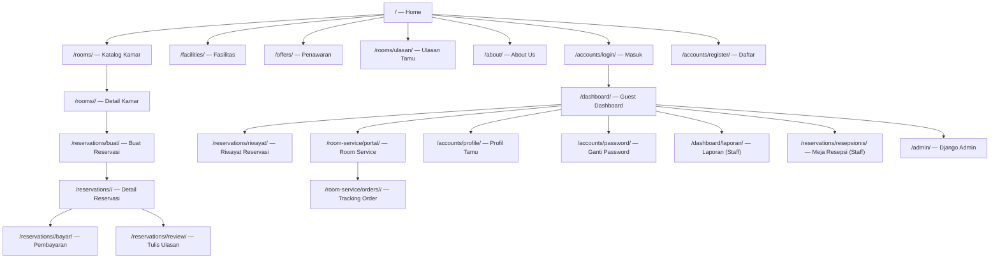

# DESIGN.md — Nocturn Haven

Dokumentasi desain website sistem manajemen hotel **Nocturn Haven**.
Ditulis berdasarkan inspeksi langsung terhadap source code, template HTML, CSS, dan JavaScript.
Setiap klaim ditandai sebagai **Fakta teramati**, **Interpretasi desain**, atau **Rekomendasi**.

---

## Daftar Isi

- [A. Overview](#a-overview)
- [B. Design Philosophy](#b-design-philosophy)
- [C. Sitemap dan Information Architecture](#c-sitemap-dan-information-architecture)
- [D. Penjelasan Desain Setiap Halaman](#d-penjelasan-desain-setiap-halaman)
- [E. Visual Design System](#e-visual-design-system)
- [F. Komponen UI dan Reusable Patterns](#f-komponen-ui-dan-reusable-patterns)
- [G. Responsive Design](#g-responsive-design)
- [H. User Flow dan Interaction Design](#h-user-flow-dan-interaction-design)
- [I. Accessibility dan Usability](#i-accessibility-dan-usability)
- [J. Hubungan Desain dan Implementasi](#j-hubungan-desain-dan-implementasi)
- [K. Design Strengths and Weaknesses](#k-design-strengths-and-weaknesses)
- [L. Design Improvement Roadmap](#l-design-improvement-roadmap)
- [M. Conclusion](#m-conclusion)

---

## A. Overview

### Identitas Website

**Fakta teramati:** Website ini adalah sistem manajemen hotel bernama **Nocturn Haven** — sebuah hotel fiksi yang digambarkan sebagai "hotel & resort mewah". Tagline yang muncul di berbagai halaman adalah *"hotel & suites dengan kamar tenang, layanan hangat, dan reservasi langsung tanpa biaya tersembunyi"*.

### Tujuan Utama

Website melayani dua kelompok pengguna secara bersamaan:

1. **Tamu publik** — menemukan informasi hotel, menjelajahi kamar, membuat reservasi, membayar, check-in/out, dan menulis ulasan.
2. **Staf/Admin** — memverifikasi pembayaran, mengelola kamar, menangani room-service order, dan melihat laporan operasional.

### Karakter Visual

**Fakta teramati:** Palet warna dominan adalah burgundy (`#710000`) dan gold (`#b68b35`) di atas kanvas krem hangat (`#f7f4f0`). Tipografi memadukan **Playfair Display** (serif elegan untuk heading) dengan **DM Sans** (sans-serif modern untuk body). Kombinasi ini membangun kesan "editorial-luxury" — mewah namun tetap bersih dan mudah dibaca.

**Fakta teramati:** Terdapat *grain overlay* tipis berupa SVG noise yang di-render sebagai elemen `position: fixed` di seluruh halaman (opacity 0.05). Ini adalah pilihan desain yang disengaja untuk memecah "kerataan digital" dan menambahkan tekstur analog.

---

## B. Design Philosophy

### 1. Luxury tanpa berlebihan

**Bukti:** Warna burgundy dan gold dipilih secara sangat terukur. Gold hanya muncul sebagai aksen — pada *eyebrow* label, garis bawah dekoratif, bintang rating, dan indikator aktif navigasi. Tidak ada elemen emas yang memenuhi layar.

**Interpretasi desain:** Ini mencerminkan prinsip "kemewahan melalui pengendalian diri" — mahal bukan karena penuh ornamen, melainkan karena setiap elemen ditempatkan dengan tujuan.

### 2. Hierarki visual yang konsisten

**Bukti:** Setiap halaman konten menggunakan struktur tiga lapisan yang sama:
- **Eyebrow label** (teks uppercase kecil berwarna gold, diikuti garis horizontal) → memperkenalkan konteks
- **Heading utama** (Playfair Display, besar) → menarik perhatian
- **Paragraf copy** (DM Sans, abu-abu lembut) → memberikan detail

Pola ini ditemukan identik di `home.html`, `facilities.html`, `room_list.html`, `about.html`, dan semua halaman publik lainnya.

### 3. Konsistensi lintas lapisan

**Bukti:** `guest-portal.css` mendefinisikan ulang token CSS yang sama persis dengan `public-site.css` — `--nh-burgundy`, `--nh-gold`, `--nh-font-display`, dst. Komentar di kepala file secara eksplisit menyatakan: *"Mirrors the tokens of the guest portal (guest-portal.css) for consistency."*

**Interpretasi desain:** Portal tamu (halaman login-required) terasa seperti satu produk yang sama dengan situs publik, bukan sistem backend yang berbeda tampilan.

### 4. Motion sebagai peningkat, bukan hiburan

**Bukti:** Terdapat tiga sistem gerakan yang diimplementasikan di `site.js`:
- **Smooth scroll** via Lenis (durasi 1.05 detik, easing eksponensial)
- **Scroll reveal** via IntersectionObserver (opacity 0 → 1, translateY 26px → 0, delay bertahap di grup)
- **Pointer tilt** pada kartu (perspective 900px, rotasiX ±5°, rotasiY ±6°)

Semua efek mengecek `prefers-reduced-motion: reduce` dan mematikan dirinya sendiri apabila aktif. Pointer tilt juga memeriksa `(hover: hover) and (pointer: fine)` sehingga tidak berjalan di layar sentuh.

### 5. Progressive enhancement

**Bukti:** Font dimuat dengan `media="print"` yang di-swap ke `all` via `onload` — teknik async font loading tanpa JavaScript. Halaman tetap terbaca tanpa font Google. Smooth scroll menggunakan `lenis.min.js` yang di-vendor secara lokal (tidak CDN), sehingga tidak bergantung jaringan eksternal untuk fungsi dasar.

### 6. Transparansi sebagai nilai brand

**Bukti:** Teks berulang di berbagai halaman: *"Harga yang Anda lihat adalah harga yang Anda bayar"*, *"Gratis pembatalan 48 jam"*, *"Pembayaran diperiksa oleh tim kami, tanpa robot"*. Ini bukan sekadar teks — ini membentuk tone of voice yang konsisten di seluruh antarmuka.

---

## C. Sitemap dan Information Architecture

### Peta Situs



### Dua Area Utama

**Area Publik** (tidak memerlukan login): Home, Kamar, Fasilitas, Penawaran, Ulasan, About, Login, Register.

**Area Tamu/Portal** (memerlukan login): Dashboard, Riwayat reservasi, Pembayaran, Room Service, Profil.

**Area Staf** (memerlukan peran Staff/Admin): Laporan operasional, Meja resepsionis, Django Admin.

**Fakta teramati:** Navigasi header hanya menampilkan tautan area publik. Akses portal tamu tersembunyi di balik chip avatar di pojok kanan header — tidak ada item menu "Dashboard" yang terlihat hingga pengguna masuk.

---

## D. Penjelasan Desain Setiap Halaman

### D.1 Halaman Beranda (`/`)

**Tujuan:** Konversi pengunjung menjadi tamu yang memesan — dengan menampilkan keindahan hotel, fasilitas, dan memudahkan pencarian ketersediaan kamar.

**Layout (atas ke bawah):**
1. **Hero full-bleed** — foto hotel dengan scrim gradient gelap, heading besar di atas foto, form pencarian kamar 4-kolom (*date range + tipe kamar*), perk strip ("Wi-Fi", "Breakfast", dll.)
2. **Seksi Kamar** — 3 kartu kamar dengan foto, label eyebrow, harga, deskripsi singkat, dan dua tombol (Lihat Detail / Pesan)
3. **Seksi Fasilitas** — 4 kartu fasilitas dalam grid otomatis
4. **Trust Band** — section dengan latar kanvas, statistik (99.8% kepuasan, 0% biaya tersembunyi, <15 mnt verifikasi), dan 4 trust point
5. **Contact Band** — kartu gelap burgundy dengan CTA menghubungi concierge

**Hierarki visual:** Foto hero memenuhi layar, mencuri perhatian pertama. Form pencarian di depan foto memastikan tujuan utama halaman (pesan kamar) selalu terlihat tanpa scroll.

**Alur pengguna utama:**
```
Tiba di homepage → Isi check-in/check-out → Klik "Cek Ketersediaan" → Pilih kamar → Pesan
```

**Pertimbangan UX:** 
- *Kekuatan:* Form pencarian terintegrasi di hero — tamu tidak perlu mencari "di mana saya bisa mulai memesan".
- *Kelemahan:* Perk strip di bawah hero tidak memiliki padding atas yang memisahkannya dengan form sehingga terasa menempel pada layar kecil (interpretasi desain).

---

### D.2 Halaman Katalog Kamar (`/rooms/`)

**Tujuan:** Membantu tamu menemukan kamar yang cocok berdasarkan tanggal, kapasitas, dan tipe.

**Layout:**
1. **Page hero** — judul + deskripsi singkat di atas latar gradient krem/gold
2. **Filter panel** — form grid 4 kolom (check-in, check-out, tamu, kategori) + filter kapasitas berupa tombol chip, tombol cari dan reset
3. **Results head** — jumlah kamar tersedia + dropdown sort (rekomendasi/harga)
4. **Listing stack** — kartu kamar dalam layout 3 kolom (foto lebar | detail | harga+CTA)

**Komponen listing card:** Setiap kartu adalah grid 3-kolom — media kiri (foto dengan badge ketersediaan), body tengah (nama, deskripsi, fitur), dan kolom harga kanan dengan latar warm canvas yang berbeda. Pemisahan visual ini jelas membedakan "informasi kamar" dari "keputusan harga".

**Interaksi:**
- Filter kapasitas menggunakan `data-capacity` attribute dan JavaScript untuk menyembunyikan (`hidden` attribute) kartu yang tidak sesuai secara real-time tanpa submit form.
- Dropdown sort mengubah urutan kartu di DOM via JavaScript.
- `data-auto-submit` attribute pada beberapa select memicu submit otomatis saat nilai berubah.

**Fakta teramati:** Ada `empty-results` state dengan border dashed yang tampil jika tidak ada kamar tersedia pada periode yang dipilih.

---

### D.3 Halaman Detail Kamar (`/rooms/<id>/`)

**Tujuan:** Memberikan informasi lengkap satu kamar untuk membantu keputusan akhir pemesanan.

**Layout:**
1. **Page hero** — eyebrow (tipe kamar), judul, deskripsi
2. **Detail layout** — grid 2 kolom: foto besar kiri (aspect-ratio 4:5, `border-radius-lg`, shadow) + info kanan (chip metadata, rating, fitur, CTA harga)
3. **Kalender ketersediaan** — grid hari kecil, 14 hari ke depan, dengan warna hijau (tersedia) dan merah-muda (terisi)
4. **Ulasan kamar** — rating summary + grid kartu ulasan

**Hierarki visual:** Foto mendominasi setengah layar kiri dengan proporsi portrait — pilihan sadar untuk menampilkan ruang kamar secara lebih mendalam dari pada foto landscape. Badge "Kamar [nomor]" melayang di pojok kiri bawah foto dengan backdrop-blur gelap.

**Komponen kalender:** Fakta teramati — kalender menggunakan CSS grid `repeat(auto-fill, minmax(74px, 1fr))` sehingga jumlah kolom menyesuaikan lebar kontainer.

---

### D.4 Halaman Form Reservasi (`/reservations/buat/`)

**Tujuan:** Mengumpulkan detail booking (kamar, tanggal, tamu, voucher) dalam satu langkah.

**Template inheritance:** Extends `reservations/base.html` → extends `public/base.html`.

**Layout:** `reservation-layout` — grid 2 kolom (form utama | aside card).
- **Form kiri:** field kamar, check-in, check-out, jumlah tamu, kode voucher opsional
- **Aside kanan:** kartu motivasi "Mengapa Nocturn Haven?" dengan 3 poin kepercayaan dan kontak email

**Interpretasi desain:** Aside bukan sekadar dekorasi — ia hadir untuk mengurangi *purchase anxiety* di momen kritis ketika pengguna mengisi form pemesanan.

**Indikator langkah:** Teks "01 — 03" muncul di kanan atas area konten (class `step-label`), memberi tahu pengguna bahwa ini adalah langkah 1 dari 3 proses. Namun tidak ada progress bar visual yang menemaninya.

---

### D.5 Halaman Pembayaran (`/reservations/<id>/bayar/`)

**Tujuan:** Mengumpulkan metode pembayaran dan bukti transfer dari tamu.

**Template inheritance:** Extends `dashboard/guest_base.html` — halaman ini sudah berada di dalam portal tamu, bukan halaman publik.

**Layout:** `nh-checkout-layout` (grid 2 kolom) — form kiri + aside instruksi bank kanan.

**Komponen keamanan:** Terdapat blok "Transaksi terlindungi" dengan ikon gembok SVG dan teks yang menjelaskan bahwa nominal dihitung di server. Ini adalah elemen trust-building yang sangat relevan untuk pembayaran manual.

**Upload file:** Terdapat `nh-upload-field` yang menampilkan teks "Pilih file bukti pembayaran" dengan informasi format dan batas ukuran (JPG/PNG/WEBP, maks 5 MB).

**Instruksi bank (aside):** Menampilkan nomor rekening, nama penerima, nominal, dan kode referensi (booking code) sebagai berita transfer. Ini sangat membantu karena semua informasi yang dibutuhkan untuk transfer ada dalam satu tampilan.

---

### D.6 Guest Dashboard (`/dashboard/`)

**Tujuan:** Pusat kendali tamu — satu tempat untuk melihat status reservasi, pembayaran, dan akses cepat ke fitur.

**Template inheritance:** Extends `dashboard/guest_base.html` yang mendefinisikan shell portal (sidebar + topbar + konten).

**Layout portal shell** (dari `guest-portal.css`):
- **Sidebar** (264px, sticky): Latar gradient burgundy gelap, brand mark, navigasi dengan icon SVG, info pengguna di bawah
- **Main area**: Topbar (nama halaman + breadcrumb) + konten utama

**Konten dashboard:**
1. **Welcome section** — sapaan nama, deskripsi singkat, 2 tombol aksi (Buat Reservasi / Pesan Room Service), ornamen dekoratif "orbit" (lingkaran dengan monogram N)
2. **Stat grid** — 4 kartu statistik kecil (total reservasi, upcoming, lunas, stay aktif)
3. **Two-column layout** — kartu stay berikutnya (kiri) + kartu kesehatan pembayaran (kanan)
4. **Recent orders** — order room service terakhir

**Ornamen orbit** (`.nh-welcome-orbit`): Interpretasi desain — elemen dekoratif berupa lingkaran konsentris dengan teks "SINCE 1987" dan monogram "N". Ini bukan fungsional, namun membangun kesan brand premium di momen penyambutan.

---

### D.7 Halaman Room Service Portal (`/room-service/portal/`)

**Tujuan:** Memungkinkan tamu memesan makanan dan minuman, melihat menu, dan berkomunikasi dengan AI concierge.

**Template inheritance:** Extends `dashboard/guest_base.html` + stylesheet tambahan `chatbot/css/room-service.css`.

**Layout portal room service:**
1. **Hero section** — copy singkat hotel + kartu info stay tamu di kanan
2. **Form pemesanan** — pilih menu dengan quantity stepper, pilih fulfillment (Delivery/Pickup), instruksi khusus
3. **Tracking order** — daftar order aktif dengan progress tracker 3 langkah
4. **Concierge Aurelia** — panel floating AI chat

**Kartu stay** (aside dalam hero): Menampilkan kode booking, tipe kamar, nomor kamar, dan tanggal check-in/out — sehingga tamu dapat mengonfirmasi pesanan dihubungkan ke reservasi yang benar.

**Fakta teramati:** Ada `nh-rs-stay-card` yang menampilkan "Belum ada reservasi" jika tamu tidak memiliki stay aktif, dengan tombol CTA untuk membuat reservasi.

---

### D.8 Halaman Ulasan Tamu (`/rooms/ulasan/`)

**Tujuan:** Menampilkan ulasan nyata tamu untuk membangun kepercayaan calon tamu baru.

**Layout:**
1. **Hero dengan rating summary** — grid 2 kolom: kiri (CTA ulasan jika tamu memiliki pending review / chip status) + kanan (panel rating dengan skor besar, bintang, dan distribusi bar per bintang)
2. **Filter ulasan** — chip row (Semua / 5★ / 4★ / 3★ / 2★ / 1★) yang berfungsi sebagai anchor link dengan query parameter
3. **Review grid** — `auto-fill minmax(320px, 1fr)` kartu ulasan

**Distribusi rating bar:** Fakta teramati — setiap baris distribusi adalah elemen `<a>` yang merupakan filter link. Bar dianimasikan via CSS `transition: width 700ms var(--ease-out)` dengan `width` di-set melalui inline style dari data server.

**CTA untuk tamu dengan pending review:** Tamu yang sudah check-out namun belum menulis ulasan melihat card gold khusus dengan tombol langsung ke form review booking mereka. Ini adalah desain kontekstual yang efektif.

---

### D.9 Halaman Autentikasi (Login & Register)

**Template inheritance:** Keduanya extends `accounts/base.html` — bukan shell portal, bukan shell publik.

**Layout:** `auth-shell` — flexbox centered, padding top dan bottom. Kartu tunggal `auth-card` dengan lebar `min(452px, 100%)`.

**Elemen kartu login:**
- Brand mark (logo + nama hotel)
- Kicker text (uppercase small)
- H1 judul
- Kotak notifikasi tips (`auth-notice`) dengan ikon "i" kuning
- Form (email, password, checkbox ingat saya)
- Divider "ATAU"
- Link daftar

**Elemen kartu register:**
- Field nama lengkap, email, telepon, password (2 kolom grid)
- Checkbox persetujuan ketentuan layanan (required)

**Interpretasi desain:** Auth card sengaja di-isolasi dari shell publik (tidak ada header/footer) untuk meminimalkan distraksi dan menjaga fokus pengguna pada satu tugas: masuk atau mendaftar.

---

### D.10 Halaman About Us (`/about/`)

**Tujuan:** Memperkenalkan tim pengembang dan prinsip pengembangan proyek.

**Layout:**
1. **Page hero** — eyebrow, heading, deskripsi, 2 CTA
2. **Intro section** — grid 2 kolom: teks proyek (kiri) + 4 stat card 2×2 (kanan)
3. **Team grid** — 3 kolom, 6 kartu tim (avatar inisial + badge role berwarna + nama + deskripsi + scope list)
4. **Values grid** — 4 kolom, 4 kartu prinsip (ikon SVG + judul + deskripsi)
5. **Contact band** — CTA dark burgundy

**Stat cards:** Plain card (`border`, `border-radius`, `box-shadow`) tanpa nesting `.bezel` — ini hasil refactor yang disengaja (lihat K. Design Weaknesses untuk konteks).

---

## E. Visual Design System

### Palet Warna

Semua nilai berikut adalah **fakta teramati** dari `:root` dalam `static/css/public-site.css`:

| Token | Nilai HEX | Fungsi |
|---|---|---|
| `--nh-burgundy` | `#710000` | Warna utama — tombol primary, heading, aksen kuat |
| `--nh-burgundy-deep` | `#4b0d16` | Burgundy lebih gelap — gradient, hover state |
| `--nh-burgundy-dark` | `#2c070d` | Sangat gelap — footer, mobile nav, contact card |
| `--nh-gold` | `#b68b35` | Aksen utama — bintang, garis eyebrow, focus ring |
| `--nh-gold-dark` | `#966f1f` | Gold lebih gelap — hover pada gold, link teks |
| `--nh-gold-soft` | `#f4e8d2` | Gold sangat muda — background chip, badge, notifikasi |
| `--nh-ink` | `#241a1c` | Teks utama — sangat gelap, bukan hitam murni |
| `--nh-ink-soft` | `#5f565a` | Teks sekunder — deskripsi, paragraf |
| `--nh-ink-faint` | `#8d8488` | Teks tersier — label, metadata, waktu |
| `--nh-surface` | `#ffffff` | Latar kartu — putih bersih |
| `--nh-surface-warm` | `#fffdf9` | Latar kartu hangat — very slight warm tint |
| `--nh-canvas` | `#f7f4f0` | Latar halaman — krem hangat, bukan putih |
| `--nh-canvas-deep` | `#efe9e1` | Kanvas lebih gelap — section backgrounds |
| `--nh-line` | `#e8e1d8` | Border default — subtle warm-tinted |
| `--nh-line-strong` | `#d9cfc2` | Border lebih tegas — input, pemisah kuat |

**Warna status** (dari `guest-portal.css`):

| Fungsi | Token | Nilai |
|---|---|---|
| Sukses (teks) | `--nh-success` | `#166534` |
| Sukses (bg) | `--nh-success-bg` | `#e3f4e8` |
| Peringatan (teks) | `--nh-warning` | `#92400e` |
| Peringatan (bg) | `--nh-warning-bg` | `#fdf0d5` |
| Bahaya (teks) | `--nh-danger` | `#991b1b` |
| Bahaya (bg) | `--nh-danger-bg` | `#fbe4e2` |
| Info (teks) | `--nh-info` | `#3730a3` |
| Info (bg) | `--nh-info-bg` | `#e8e7fd` |

**Catatan:** Terdapat file `static/css/custom.css` yang mendefinisikan token berbeda (`--nh-maroon: #6a0d18`, `--nh-gold: #c5a059`, dll.) menggunakan `Plus Jakarta Sans` sebagai font. File ini tampaknya adalah CSS dari iterasi pengembangan sebelumnya atau alternatif yang belum diintegrasikan ke template aktif, karena tidak ditemukan `<link>` ke `custom.css` di template manapun yang diperiksa.

---

### Tipografi

**Fakta teramati:**

| Token | Nilai | Fallback |
|---|---|---|
| `--nh-font-display` | `"Playfair Display"` | Georgia, "Times New Roman", serif |
| `--nh-font-body` | `"DM Sans"` | "Segoe UI", Arial, sans-serif |

**Hierarki heading (public site):**

| Elemen | Ukuran | Font | Penggunaan |
|---|---|---|---|
| `h1` (hero) | `clamp(38px, 6vw, 72px)` | Playfair Display | Heading hero halaman beranda |
| `h1` (page hero) | `clamp(30px, 4vw, 48px)` | Playfair Display | Heading halaman internal |
| `h2` (section) | `clamp(28px, 3.4vw, 42px)` | Playfair Display | Judul seksi |
| `h3` (card) | `22px` | Playfair Display | Judul kartu kamar/fasilitas |
| Body | `15px` | DM Sans | Paragraf umum |
| Label/Eyebrow | `11px`, uppercase, `letter-spacing: 0.24em` | DM Sans | Label kategori, metadata |
| Caption/Small | `12–13px` | DM Sans | Metadata kecil, jam, label |

**Line height:** Body `1.6`, portal body `1.55`. Semua heading menggunakan `text-wrap: balance` dan body menggunakan `text-wrap: pretty` — keduanya adalah properti modern untuk hasil teks yang lebih rapi secara visual.

---

### Spacing dan Layout

**Fakta teramati:**

| Konteks | Nilai |
|---|---|
| Lebar konten maksimum | `min(1260px, calc(100% - 40px))` via `.pub-shell` |
| Padding seksi publik | `88px 0 28px` via `.pub-section` |
| Padding page body | `42px 0 84px` via `.page-body` |
| Gap grid kamar | `22px` |
| Gap grid fasilitas | `22px` |
| Gap filter panel | `14px` |

**Grid patterns yang digunakan:**
- Hero search panel: `repeat(4, 1fr) auto` (5 kolom)
- Room grid: `auto-fit minmax(300px, 1fr)`
- Facility grid: `auto-fit minmax(260px, 1fr)`
- Listing card: `1.05fr 1fr 240px` (3 kolom tetap)
- Trust grid: `0.9fr 1.1fr` (2 kolom, non-simetris)
- Portal shell: `264px 1fr` (sidebar + main)
- Review grid: `auto-fill minmax(320px, 1fr)`

---

### Bentuk dan Detail Visual

**Border radius** (fakta teramati):

| Token | Nilai | Penggunaan |
|---|---|---|
| `--nh-radius-sm` | `10px` | Input, filter chip, badge |
| `--nh-radius` | `18px` | Kartu standar |
| `--nh-radius-lg` | `28px` | Kartu besar (bezel, room card, listing) |
| `--nh-radius-pill` | `999px` | Tombol, chip, header, avatar |

**Shadow tokens** (fakta teramati):

| Token | Nilai |
|---|---|
| `--nh-shadow-soft` | `0 4px 16px -10px rgba(44,7,13,0.28)` |
| `--nh-shadow` | `0 18px 44px -26px rgba(44,7,13,0.45)` |
| `--nh-shadow-lift` | `0 30px 60px -34px rgba(44,7,13,0.55)` |
| `--nh-ring-gold` | `inset 0 1px 0 rgba(255,255,255,0.22), 0 0 0 1px rgba(182,139,53,0.38)` |

**Perhatikan:** Semua shadow menggunakan warna burgundy gelap (`rgb(44,7,13)`) sebagai dasar, bukan hitam. Ini membuat bayangan terasa "hangat" dan selaras dengan palet.

**Grain overlay:** Fixed `z-index: 60`, `pointer-events: none`, `opacity: 0.05`. Dirender sebagai SVG fractal noise inline di CSS. Di bawah grain (z-index 50) ada header.

**Komponen Bezel:** Pola double-card — wrapper `.bezel` (padding 8px, background semi-transparan, border subtle, shadow) membungkus `.bezel-core` (background putih, inner-shadow). Efeknya menyerupai bingkai emboss atau matting foto. Digunakan pada room card, facility card, dan offers card.

---

## F. Komponen UI dan Reusable Patterns

### Tombol (`.btn`)

**Fakta teramati — 5 varian:**

| Kelas | Tampilan | Penggunaan |
|---|---|---|
| `.btn--primary` | Gradient burgundy, teks krem, ring gold | Aksi utama (Pesan Sekarang, Lanjutkan) |
| `.btn--gold` | Gradient gold, teks gelap | CTA sekunder premium (Hubungi Concierge, Reservasi di contact band) |
| `.btn--ghost` | Latar putih, border abu, teks burgundy | Aksi sekunder (Kembali, Reset) |
| `.btn--pale` | Semi-transparan putih, border putih samar | CTA di latar gelap (contact card, mobile nav) |
| `.btn--link` | Transparan, teks gold | Link dalam konteks teks |

Semua tombol memiliki `min-height: 46px`, `border-radius: pill`, `.btn:active { transform: translateY(1px) }`, dan `.btn:disabled { opacity: 0.5 }`.

**`.btn__icon`:** Trailing icon berbentuk lingkaran dengan latar semi-transparan yang bergeser 2px ke kanan saat hover.

---

### Eyebrow Label (`.pub-eyebrow`)

Komponen teks label uppercase kecil (11px, `letter-spacing: 0.24em`, warna gold-dark) diikuti garis horizontal dekoratif via `::after` pseudo-element. Digunakan sebagai pembuka setiap seksi di seluruh halaman publik.

---

### Chip dan Badge

**Chip (`.chip`):** Pill kecil dengan border, background warm, teks abu. Digunakan untuk metadata kamar (kapasitas, ukuran, view) dan filter. Varian `.chip--gold` dengan background gold-soft.

**Badge (`.badge`):** Pill status warna-warni. 4 varian: `--success` (hijau), `--warning` (amber), `--muted` (abu), `--danger` (merah).

---

### Kartu Kamar (`.room-card`)

Fakta teramati — kartu di halaman beranda dan offers menggunakan pola `.room-card.bezel[data-tilt]` dengan struktur:
- `.room-card__media` — foto aspect-ratio 4:3, hover zoom `scale(1.05)`
- Tag eyebrow di pojok kiri atas foto (dark pill)
- Badge harga di pojok kanan bawah foto (light pill)
- `.room-card__body` — meta chips, nama, deskripsi, fitur list, tombol aksi

---

### Listing Card (`.listing-card`)

Digunakan di halaman katalog kamar (`/rooms/`). Grid 3-kolom berbeda dari room card: media kiri (full-height), body tengah, kolom harga kanan dengan latar berbeda. Ini memberikan lebih banyak informasi per kartu karena dioptimalkan untuk perbandingan, bukan showcase.

---

### Review Card (`_review_card.html`)

Template include yang digunakan di dua tempat: halaman ulasan dan detail kamar. Struktur: avatar inisial (gradient burgundy) + nama + room type + rating bintang + kutipan dengan border-left gold + footer dengan chip "Tamu terverifikasi" + tanggal menginap.

---

### Star Rating

**Dua implementasi:**
1. **Display** (`_stars.html`): Template include, render ★ berwarna/tidak berwarna via class `is-filled`. Memiliki `aria-label="Rating X dari 5"`.
2. **Input** (`.star-input`): CSS-only star selector menggunakan `:has(input:checked)` dan sibling selector. Dikombinasikan dengan `display: flex; flex-direction: row-reverse` untuk trik CSS clasik yang memungkinkan highlight kumulatif saat hover.

---

### Sidebar Portal (`guest-portal.css`)

**Fakta teramati:** Sidebar 264px dengan `position: sticky, top: 0, height: 100vh`. Latar gradient burgundy gelap dengan radial gold di pojok kanan atas. Navigasi menggunakan link dengan ikon SVG (stroke, bukan fill). Active state memiliki `box-shadow: inset 3px 0 0 var(--nh-gold)` — garis indikator kiri berwarna gold. User info di bagian paling bawah sidebar.

---

### Status Pill (`.nh-status`)

Digunakan di portal untuk menampilkan status reservasi dan pembayaran. Terdapat kelas modifier per status (`nh-status-paid`, `nh-status-pending`, dll.) dengan warna berbeda.

---

## G. Responsive Design

**Fakta teramati** — breakpoint dari `public-site.css`:

| Breakpoint | Perubahan utama |
|---|---|
| `≤ 1180px` | Desktop nav disembunyikan, hamburger muncul; listing card menjadi 2 kolom |
| `≤ 1024px` | Trust grid, detail layout, review hero, two-col menjadi 1 kolom; reservation layout 1 kolom; search panel 2 kolom |
| `≤ 960px` | About intro menjadi 1 kolom; about stats melebar jadi 4 kolom |
| `≤ 760px` | Font body turun ke 14.5px; header mengecil; brand copy disembunyikan; header actions menyembunyikan tombol booking; pub-shell lebih sempit; section-head menjadi block; listing card menjadi block; field grid menjadi block |
| `≤ 640px` | Team grid 1 kolom; about stats 2 kolom; values grid 1 kolom |
| `≤ 480px` | Avatar chip hanya ikon (label disembunyikan) |

**Mobile navigation:** Pada ≤1180px, nav desktop (`display: none`) digantikan tombol hamburger. Klik membuka `mobile-nav` yang merupakan overlay full-screen gelap dengan blur backdrop, menampilkan link besar bergaya editorial (Playfair Display 24px) dengan nomor urut di kanan. Animasi: slide dari bawah (translateY 14px → 0) dengan delay bertahap per item.

**Catatan keterbatasan:** Tidak ada screenshot atau tampilan aktual yang diperiksa. Responsivitas berdasarkan pembacaan CSS saja. Tampilan aktual pada perangkat nyata belum diverifikasi.

---

## H. User Flow dan Interaction Design

### Alur Utama: Reservasi dan Pembayaran

```mermaid
flowchart TD
    A[Tamu tiba di homepage] --> B{Sudah login?}
    B -- Tidak --> C[Isi form pencarian / klik Pesan]
    C --> D[Redirect ke login]
    D --> E[Login / Daftar]
    B -- Ya --> F[Isi form pencarian]
    E --> F
    F --> G[/rooms/ - Pilih kamar]
    G --> H[/rooms/id/ - Lihat detail]
    H --> I[Klik 'Pesan Kamar Ini']
    I --> J[/reservations/buat/ - Form booking]
    J --> K{Form valid?}
    K -- Tidak --> J
    K -- Ya --> L[/reservations/id/ - Detail reservasi]
    L --> M[Klik 'Lanjutkan Pembayaran']
    M --> N[/reservations/id/bayar/ - Form pembayaran]
    N --> O[Unggah bukti transfer]
    O --> P[Status: Menunggu Verifikasi]
    P --> Q{Admin verifikasi}
    Q -- Tolak --> R[Status: Ditolak - Bisa retry]
    Q -- Setujui --> S[Status: Lunas - Booking Confirmed]
    S --> T[Check-in di hotel]
    T --> U[Check-out - tulis ulasan]
```

### State Antarmuka yang Diimplementasikan

**Fakta teramati:**

| State | Implementasi |
|---|---|
| Default | Semua halaman utama |
| Hover | Kartu zoom foto, shadow lift, tombol — semua via CSS transition |
| Focus | `outline: 3px solid var(--nh-gold)` di semua elemen fokus |
| Active | `transform: translateY(1px)` pada tombol dan link nav |
| Loading | Tidak ditemukan spinner eksplisit; browser default saat form submit |
| Empty state | `.empty-results` di katalog kamar (border dashed, teks centered) |
| Error state | `.auth-error`, `.form-error`, `.nh-alert-error` (background merah muda) |
| Success | `.alert-success`, `.nh-alert-success` (background hijau muda) |
| Disabled | `.btn:disabled { opacity: 0.5; cursor: not-allowed; transform: none }` |
| Scroll reveal | `opacity: 0; translateY(26px)` → `.is-revealed` via IntersectionObserver |
| Tilt 3D | Card bezel hover via pointer tilt JavaScript |
| Header scrolled | `.is-scrolled` menambah opacity dan shadow saat scroll > 24px |
| Mobile nav open | `.is-open` pada `.mobile-nav`, scroll locked |

**State yang tidak ditemukan:** Loading spinner untuk operasi async, skeleton loading state, optimistic UI update. Ini karena hampir semua operasi adalah form POST sinkron, kecuali polling room service (setiap 15 detik).

---

## I. Accessibility dan Usability

### Yang Sudah Diimplementasikan (Fakta teramati)

| Aspek | Status | Bukti |
|---|---|---|
| Skip link | ✅ Hadir | `.skip-link` di semua halaman publik, muncul saat fokus |
| Focus indicator | ✅ Konsisten | `3px solid var(--nh-gold)` di semua elemen interaktif |
| `aria-current="page"` | ✅ Diimplementasikan | Nav header cek `url_name` dan set atribut |
| `aria-label` pada nav | ✅ Ada | `aria-label="Navigasi utama"`, `aria-label="Navigasi seluler"` |
| `aria-expanded` hamburger | ✅ Toggle | JavaScript update atribut saat open/close |
| `aria-hidden` pada ikon dekoratif | ✅ Konsisten | SVG ikon menggunakan `aria-hidden="true"` |
| Alt text gambar | ✅ Deskriptif | Foto hotel dan kamar memiliki deskripsi yang bermakna |
| Star rating display | ✅ Accessible | `role="img" aria-label="Rating X dari 5"` |
| Star input focus | ✅ Ada | `.star-input label:focus-within { outline }` |
| Heading hierarchy | ✅ Logis | H1 satu per halaman, H2 untuk seksi, H3 untuk kartu |
| Keyboard escape mobile nav | ✅ Diimplementasikan | `keydown: Escape` menutup mobile nav dan mengembalikan fokus |
| `prefers-reduced-motion` | ✅ Diimplementasikan | Lenis, reveal, tilt semua dimatikan |
| `lang="id"` | ✅ Di-set | HTML tag di `base.html` |
| Checkbox required | ✅ Hadir | Form registrasi memerlukan persetujuan ketentuan |

### Yang Perlu Verifikasi Lebih Lanjut

- **Kontras warna:** Token `--nh-ink-faint: #8d8488` di atas `--nh-canvas: #f7f4f0` perlu diperiksa rasio kontrasnya — kemungkinan di bawah 4.5:1 untuk teks kecil. *(Memerlukan pengujian dengan contrast checker)*
- **Form label association:** Beberapa form menggunakan `<label class="field">` yang membungkus input (implicit association), sedangkan beberapa lainnya mungkin menggunakan explicit `for/id`. Belum semua diperiksa.
- **Error message association:** Teks error ditampilkan sebagai `<small class="error-text">` di dalam `<label>`. Perlu dipastikan screen reader membacanya saat terjadi error.
- **Portal sidebar:** Pada layar sempit, sidebar tidak memiliki mekanisme collapse yang terlihat dalam CSS yang diperiksa.

---

## J. Hubungan Desain dan Implementasi

### Struktur File

```
static/
├── css/
│   ├── public-site.css       # Design system publik (token + komponen lengkap)
│   └── custom.css            # CSS lama/alternatif, tidak digunakan aktif
├── js/
│   ├── site.js               # Interaksi: Lenis, reveal, tilt, mobile nav, header
│   ├── admin-motion.js       # Motion untuk admin panel
│   └── vendor/lenis.min.js   # Smooth scroll library (vendored)
└── images/                   # Gambar statis (belum diperiksa isinya)

dashboard/static/dashboard/
├── css/
│   ├── guest-portal.css      # Design system portal tamu (shell + komponen portal)
│   └── admin-theme.css       # Tema burgundy/gold untuk Django admin
└── images/
    └── logo.svg              # Logo hotel (SVG)

chatbot/static/chatbot/
├── css/room-service.css      # Komponen khusus room service portal
└── js/room-service.js        # Interaksi room service (polling, concierge chat)
```

### Template Inheritance Chains

```
1. Halaman Publik:
   templates/public/base.html
   └── dashboard/templates/dashboard/home.html
   └── dashboard/templates/dashboard/facilities.html
   └── dashboard/templates/dashboard/offers.html
   └── dashboard/templates/dashboard/about.html
   └── rooms/templates/rooms/room_list.html
   └── rooms/templates/rooms/room_detail.html
   └── rooms/templates/rooms/review_list.html

2. Halaman Reservasi (hybrid publik):
   templates/public/base.html
   └── reservations/templates/reservations/base.html
       └── reservations/templates/reservations/booking_form.html
       └── reservations/templates/reservations/booking_detail.html
       └── reservations/templates/reservations/review_form.html

3. Portal Tamu:
   dashboard/templates/dashboard/guest_base.html
   └── dashboard/templates/dashboard/guest_dashboard.html
   └── accounts/templates/accounts/profile.html
   └── reservations/templates/reservations/payment_form.html
   └── chatbot/templates/chatbot/room_service_portal.html

4. Autentikasi (terpisah):
   accounts/templates/accounts/base.html
   └── accounts/templates/accounts/login.html
   └── accounts/templates/accounts/register.html

5. Admin:
   Django admin default + admin-theme.css override
```

### Template Tags Kustom

**Fakta teramati:**
- `dashboard.templatetags.hotel_ui` → filter `rupiah`: memformat angka sebagai mata uang Rupiah Indonesia (`5610000` → `5.610.000`)
- `dashboard.templatetags.hotel_admin` → tag `admin_metrics` untuk sidebar admin
- `chatbot.templatetags.room_service` → template tags khusus room service

---

## K. Design Strengths and Weaknesses

### Kekuatan

| Temuan | Bukti | Dampak |
|---|---|---|
| **Token CSS terpusat dan konsisten** | 16+ token warna, 4 radius, 4 shadow, 2 font — semuanya di `:root` | Perubahan warna cukup di satu tempat; seluruh site update otomatis |
| **Hierarki visual yang sangat jelas** | Pola eyebrow → heading → copy identik di semua halaman | Pengguna tidak perlu belajar ulang cara membaca halaman baru |
| **Motion yang bertanggung jawab** | `prefers-reduced-motion` check di 3 tempat; Lenis dimatikan, reveal langsung visible | Aksesibel untuk pengguna dengan vestibular disorders |
| **Loading font tidak memblok render** | `media="print"` swap trick | Core content visible lebih cepat bahkan jika font CDN lambat |
| **Grain overlay sebagai detail premium** | Inline SVG noise, `opacity: 0.05`, `pointer-events: none` | Menambahkan tekstur premium tanpa biaya performa yang berarti |
| **Trust signals terintegrasi di alur** | Aside pada form booking; blok keamanan pada form pembayaran; "Tamu terverifikasi" chip | Mengurangi anxiety tepat di momen keputusan kritis |
| **Font terhitung dengan `clamp()`** | H1 hero: `clamp(38px, 6vw, 72px)` | Scaling mulus di semua ukuran layar tanpa breakpoint tambahan |

### Kelemahan

| Temuan | Bukti | Dampak | Prioritas |
|---|---|---|---|
| **`custom.css` tidak digunakan aktif** | File mendefinisikan token berbeda (`--nh-maroon`, font `Plus Jakarta Sans`) tapi tidak ada `<link>` ke file ini di template manapun | Kebingungan developer, potensi konflik jika ditautkan | Sedang |
| **Progress booking tidak visual** | Teks "01 — 03" muncul tapi tanpa progress bar | Pengguna tidak tahu berapa langkah tersisa secara visual | Sedang |
| **Portal sidebar tidak collapse di mobile** | CSS tidak mendefinisikan perilaku sidebar pada layar sempit | Kemungkinan layout rusak atau sidebar penuh layar di perangkat kecil | Tinggi |
| **Tidak ada loading state sinkron** | Form submit mengandalkan browser default (cursor loading) | Pengguna bisa mengklik tombol berkali-kali karena tidak ada feedback visual segera | Sedang |
| **Kontras warna `--nh-ink-faint`** | `#8d8488` di atas `#f7f4f0` — kontras estimasi ~3.8:1 (di bawah WCAG AA 4.5:1 untuk teks kecil) | Teks faint (label, metadata) mungkin sulit dibaca | Tinggi |
| **Star input CSS-only bergantung `:has()`** | `.star-input label:has(input:checked)` | `:has()` tidak didukung browser lama (Firefox < 121) | Rendah |
| **Form panjang tanpa autosave** | Form booking dan profil cukup panjang | Jika session expire atau navigasi tidak sengaja, data hilang | Rendah |

---

## L. Design Improvement Roadmap

### Prioritas 1 — Masalah Fungsional

**1. Sidebar portal di layar sempit**
- **Masalah:** Sidebar 264px tidak memiliki perilaku collapse di CSS yang terdeteksi.
- **Solusi:** Tambahkan breakpoint `≤ 1024px` yang mengubah `grid-template-columns: 1fr` dan menyembunyikan sidebar dengan `transform: translateX(-100%)` + toggle button. Pindahkan navigasi ke hamburger menu.
- **Manfaat:** Portal dapat digunakan di tablet dan mobile.

**2. Loading state pada form submit**
- **Masalah:** Tidak ada feedback visual saat form sedang diproses.
- **Solusi:** Tambahkan JavaScript sederhana yang menambah class `is-loading` pada button saat form submit, mengubah teks dan menambah spinner.
- **Manfaat:** Mencegah double-submit, memberi kepercayaan kepada pengguna bahwa aksi mereka berhasil dicatat.

### Prioritas 2 — Usability dan Konsistensi

**3. Kontras teks faint**
- **Masalah:** `--nh-ink-faint: #8d8488` kemungkinan tidak memenuhi WCAG AA untuk teks kecil.
- **Solusi:** Gelapkan sedikit menjadi ≈`#706a6e` dan verifikasi kontras dengan checker.
- **Manfaat:** Aksesibilitas lebih baik tanpa mengubah karakter visual.

**4. Visual progress indicator untuk alur reservasi**
- **Masalah:** Pengguna hanya melihat teks "01 — 03".
- **Solusi:** Tambahkan komponen step indicator bergaris (step 1 · 2 · 3) di bagian atas `reservations/base.html`.
- **Manfaat:** Pengguna tahu persis posisi mereka dalam proses pemesanan.

**5. Hapus atau integrasikan `custom.css`**
- **Masalah:** File CSS berisi token dan font berbeda, tidak ditautkan ke mana pun.
- **Solusi:** Jika tidak dibutuhkan, hapus file. Jika untuk Bootstrap-based views, pastikan hanya dimuat di template spesifik.
- **Manfaat:** Mengurangi kebingungan developer, mencegah konflik CSS tidak disengaja.

### Prioritas 3 — Penyempurnaan Visual

**6. Ilustrasi atau ikon dekoratif yang lebih kaya**
- **Masalah:** Fasilitas dan fitur kamar menggunakan teks simbol (`✦`) atau tidak ada ikon.
- **Solusi:** Gunakan set ikon SVG konsisten untuk fitur kamar (AC, TV, bath, wifi, dll.).
- **Manfaat:** Scanning informasi lebih cepat secara visual.

**7. Empty state untuk halaman ulasan tanpa filter**
- **Masalah:** Jika belum ada ulasan sama sekali, tampilan kosong kurang informatif.
- **Solusi:** Ilustrasi ringan + CTA "Jadilah tamu pertama yang mengulas".
- **Manfaat:** Halaman tidak terasa rusak saat database baru.

### Prioritas 4 — Pengembangan Lanjutan

**8. Dark mode**
- `admin-theme.css` sudah memiliki `html[data-theme="dark"]` dengan token lengkap. Ini bisa diperluas ke public site dan portal.
- **Manfaat:** Kenyamanan pengguna malam hari, sesuai dengan nama "Nocturn Haven".

**9. Animasi page transition**
- Saat ini tidak ada transisi antar halaman (Django reload penuh).
- **Solusi:** View Transitions API (Chrome 111+) atau Turbo untuk transisi halus.
- **Manfaat:** Pengalaman yang lebih mulus dan terasa seperti aplikasi.

**10. Gambar kamar dari database**
- Saat ini semua foto kamar adalah URL Unsplash yang di-hardcode di view.
- **Solusi:** Tambahkan field `ImageField` pada `RoomType` untuk upload foto.
- **Manfaat:** Admin dapat mengelola foto tanpa sentuh kode.

---

## M. Conclusion

### Karakter Desain

Nocturn Haven adalah desain "editorial-luxury" — mengutamakan keeleganan tipografis dan keterbacaan di atas akrobat visual. Ini bukan desain yang mencolok, melainkan desain yang *meyakinkan*: setiap detail mulai dari grain overlay hingga shadow berbasis warna burgundy, dari `clamp()` pada heading hingga pilihan `text-wrap: balance`, menunjukkan pemikiran yang matang.

### Prinsip Paling Dominan

**Konsistensi** adalah prinsip terkuat. Token CSS yang identik antara `public-site.css` dan `guest-portal.css`, pola eyebrow → heading → copy yang berulang di setiap halaman, dan penggunaan komponen yang sama (chip, badge, bezel) di seluruh surface menunjukkan visi desain yang terpadu.

### Kekuatan Utama

1. Sistem token CSS yang matang dan benar-benar dipakai secara konsisten
2. Motion yang aksesibel — semua efek bisa dimatikan dengan `prefers-reduced-motion`
3. Trust signals yang tertanam di titik keputusan kritis (booking dan pembayaran)
4. Font loading strategy yang tidak memblok render

### Kelemahan Penting

1. Portal tamu kemungkinan tidak berfungsi optimal di mobile (sidebar tidak collapse)
2. Tidak ada loading state saat operasi server berlangsung
3. Satu file CSS (`custom.css`) yang tidak aktif digunakan namun ada di repository — potensi kebingungan

### Arah Pengembangan yang Paling Masuk Akal

Prioritas paling mendesak adalah **mobile portal experience** — saat ini sisi publik sudah responsif, namun portal tamu (area yang paling sering dikunjungi berulang) kemungkinan memerlukan perbaikan pada layar kecil. Setelah itu, **loading states** adalah quick win yang besar dampaknya terhadap persepsi kualitas dengan investasi kode yang minimal.

Untuk jangka menengah, **dark mode** adalah fitur yang paling selaras secara konseptual dengan identitas brand — "Nocturn" secara harfiah berarti malam.

---

*Dokumentasi ini ditulis berdasarkan inspeksi langsung terhadap source code pada Oktober 2026. Screenshot atau tampilan aktual di browser tidak tersedia dan tidak digunakan sebagai sumber. Beberapa evaluasi responsivitas dan aksesibilitas bersifat estimasi berdasarkan pembacaan CSS.*
