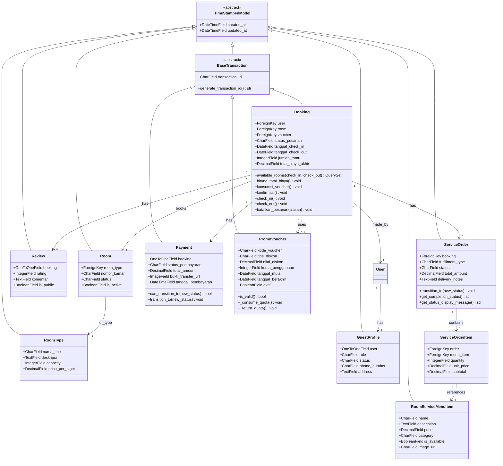
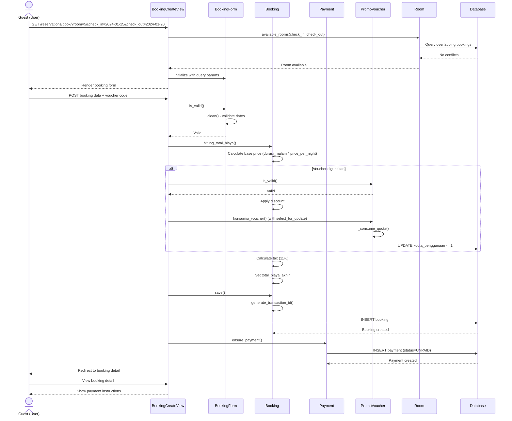
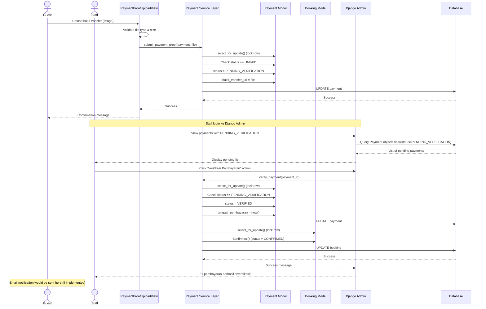
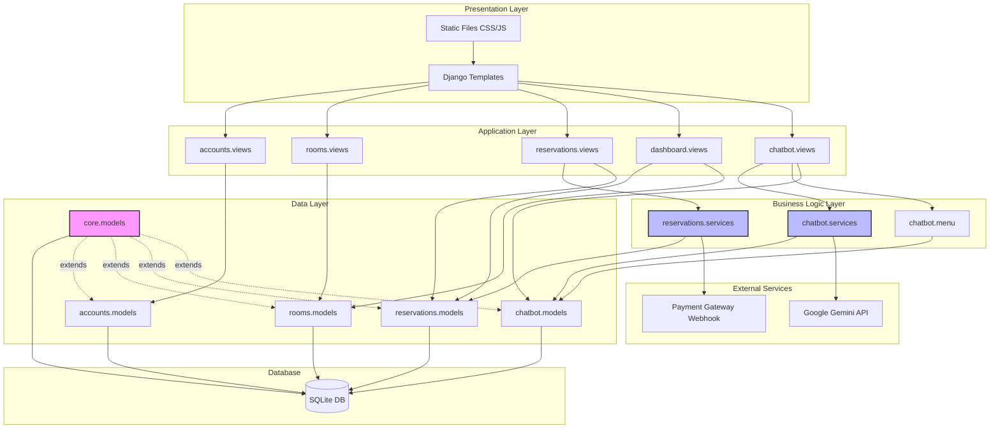

# FEATURES_AND_PBO.md
# Sistem Manajemen Hotel Nocturn Haven
## Dokumentasi Fitur dan Implementasi Pemrograman Berorientasi Objek (PBO)

---

**Dokumen ini menjelaskan:**
1. Fitur-fitur aktual yang diimplementasikan dalam sistem
2. Implementasi konsep Pemrograman Berorientasi Objek (PBO) dalam kode sumber

**Catatan Penting:** Semua informasi dalam dokumen ini berdasarkan analisis kode sumber aktual. Tidak ada fitur atau konsep yang dibuat-buat.

---

## Daftar Isi

- [A. Project Overview](#a-project-overview)
- [B. Feature Inventory](#b-feature-inventory)
- [C. Feature-by-Feature Explanation](#c-feature-by-feature-explanation)
- [D. OOP Fundamentals in This Project](#d-oop-fundamentals-in-this-project)
- [E. The Four Pillars of OOP](#e-the-four-pillars-of-oop)
- [F. OOP Implementation Matrix](#f-oop-implementation-matrix)
- [G. Class and Architecture Diagrams](#g-class-and-architecture-diagrams)
- [H. Detailed Code Walkthroughs](#h-detailed-code-walkthroughs)
- [I. Implementation Quality](#i-implementation-quality-and-improvement-opportunities)
- [J. Conclusion](#j-conclusion)
- [K. Appendix: Source File Reference](#k-appendix-source-file-reference)

---

## A. Project Overview

### Tujuan Sistem

**Nocturn Haven Hotel Management System** adalah aplikasi manajemen hotel berbasis web yang dibangun dengan Django 6.1. Sistem ini mengotomatisasi seluruh siklus perjalanan tamu hotel, mulai dari pencarian kamar, pemesanan, pembayaran, check-in, check-out, hingga ulasan dan layanan room service dengan AI concierge bernama Aurelia (diperkuat oleh Google Gemini).

### Masalah yang Diselesaikan

Berdasarkan analisis kode sumber, sistem ini menyelesaikan masalah-masalah berikut:

1. **Manajemen Reservasi Manual** - Sistem menggantikan proses booking manual dengan workflow digital yang terintegrasi dengan pencegahan double booking menggunakan database locking
2. **Verifikasi Pembayaran** - Menyediakan jalur verifikasi pembayaran manual oleh staff dan webhook otomatis dari payment gateway dengan HMAC-SHA256 signature
3. **Komunikasi Layanan Kamar** - Portal room service dengan menu digital 34 item, pelacakan pesanan real-time, dan AI concierge untuk rekomendasi
4. **Transparansi Operasional** - Dashboard untuk tamu dan staff dengan metrik real-time tentang status reservasi, pembayaran, dan pesanan
5. **Ketersediaan Kamar** - Sistem cerdas untuk mencegah double booking dengan `select_for_update()` database locking dan validasi overlap tanggal

### Role Pengguna Utama

Berdasarkan `accounts/models.py` dan `accounts/views.py`, sistem mendukung tiga role:

| Role | Kode di Database | Hak Akses | Implementasi |
|---|---|---|---|
| **Guest (Tamu)** | `'GUEST'` | Buat reservasi, upload bukti bayar, lihat riwayat booking, pesan room service, tulis ulasan | `GuestProfile.role = 'GUEST'` |
| **Staff** | `'STAFF'` | Verifikasi pembayaran, check-in/check-out tamu, ubah status kamar, proses pesanan room service | `GuestProfile.role = 'STAFF'`, `is_staff=True` |
| **Admin** | `'ADMIN'` | Semua hak staff + kelola user, kelola menu, akses laporan lengkap, kelola room types | `GuestProfile.role = 'ADMIN'`, `is_staff=True` |

Role dikelola melalui model `GuestProfile` di `accounts/models.py` yang memiliki field `role` dengan pilihan `ROLE_CHOICES`.

### Teknologi dan Framework

**Backend:**
- **Django 6.1** - Framework web Python
- **SQLite** - Database development (file: `db.sqlite3`)
- **PostgreSQL** - Disebutkan di README untuk production, belum dikonfigurasi
- **Google Gemini API** - AI concierge (Google Gen AI SDK)
- **python-dotenv** - Manajemen environment variables

**Frontend:**
- **Django Templates** - Server-rendered HTML
- **Custom CSS** - Design system berbasis CSS custom properties (file: `static/css/public-site.css`)
- **Vanilla JavaScript** - Interaktivitas tanpa framework
- **Lenis.js** - Smooth scrolling library (vendored di `static/js/vendor/lenis.min.js`)

**Arsitektur:**
- **Monolithic Django Application** - Satu aplikasi Django dengan multiple apps
- **Server-Rendered** - Hampir semua halaman menggunakan Django templates
- **JSON API Endpoints** - Hanya untuk polling status pesanan dan chat concierge

### Aplikasi Django

Berdasarkan `config/settings.py`, sistem terdiri dari 5 aplikasi custom:

| App | Tanggung Jawab | File Utama |
|---|---|---|
| `accounts` | Autentikasi, registrasi, profil tamu, manajemen role | `accounts/models.py` (User, GuestProfile) |
| `rooms` | Tipe kamar, kamar, ketersediaan | `rooms/models.py` (RoomType, Room, RoomAvailability) |
| `reservations` | Booking, payment, voucher, review, modifikasi | `reservations/models.py` (8 models) |
| `dashboard` | Homepage publik, portal tamu, laporan staff | `dashboard/views.py` (10+ views) |
| `chatbot` | Menu room service, pesanan, AI concierge | `chatbot/models.py` (4 models), `chatbot/services.py` |
| `core` | Abstract base models untuk timestamp | `core/models.py` (TimeStampedModel) |

**Catatan:** App `guests` ada di struktur folder tetapi **tidak** diaktifkan di `INSTALLED_APPS` dan tidak berisi kode.

### Arsitektur Keseluruhan

Sistem ini memiliki dua area utama:

1. **Area Publik** (tidak perlu login):
   - Homepage (`/`)
   - Katalog kamar (`/rooms/`)
   - Detail kamar (`/rooms/<id>/`)
   - Ulasan tamu (`/rooms/ulasan/`)
   - Fasilitas (`/facilities/`)
   - Penawaran (`/offers/`)
   - About (`/about/`)
   - Login/Register (`/accounts/login/`, `/accounts/register/`)

2. **Area Portal Tamu** (perlu login):
   - Dashboard tamu (`/dashboard/`)
   - Riwayat reservasi (`/reservations/riwayat/`)
   - Form booking (`/reservations/buat/`)
   - Upload pembayaran (`/reservations/<id>/bayar/`)
   - Room service portal (`/room-service/portal/`)
   - Profil (`/accounts/profile/`)

3. **Area Staff** (perlu role Staff/Admin):
   - Admin dashboard (`/dashboard/admin-panel/`)
   - Verifikasi pembayaran (`/dashboard/admin-panel/payments/`)
   - Reception desk (`/dashboard/admin-panel/reception/`)
   - Housekeeping (`/housekeeping/`)
   - Laporan (`/dashboard/laporan/`)
   - Django Admin (`/admin/` - redirect ke custom admin)

### Relasi Sistem Publik dan Internal

Berdasarkan `config/urls.py` dan `dashboard/views.py`:

- **Sistem Publik** = Website marketing hotel yang bisa diakses siapa saja
- **Portal Tamu** = Area login untuk tamu yang sudah punya akun
- **Sistem Internal** = Area staff untuk operasional hotel

Ketiganya terintegrasi dalam satu aplikasi Django dengan:
- Autentikasi: Django's built-in User model + custom GuestProfile
- Authorization: Role-based melalui `GuestProfile.role` dan decorators di `accounts/views.py`
- Shared design system: CSS tokens yang sama di `public-site.css` dan `guest-portal.css`

---

## B. Feature Inventory

Tabel berikut mendokumentasikan **semua fitur yang ditemukan dalam kode sumber aktual**. Status implementasi berdasarkan keberadaan model, view, form, dan routing yang dapat diverifikasi.

### 1. Public Website Features

| Feature | Purpose | User | Main Classes | Main Methods | Source Files | DB Interaction | Status |
|---|---|---|---|---|---|---|---|
| **Homepage** | Menampilkan informasi hotel, showcase kamar, fasilitas | Public | N/A (template only) | N/A | `dashboard/views.py::DashboardView`, `templates/public/base.html` | Read Room, RoomType | **Implemented, not verified** |
| **Room Catalog** | Browsing dan filter kamar berdasarkan tanggal, tipe, kapasitas | Public | Room, RoomType, Booking | `Booking.available_rooms()` | `rooms/views.py::room_list()`, `rooms/models.py` | Read Room, check overlapping Bookings | **Implemented, not verified** |
| **Room Detail** | Info lengkap kamar, kalender 14 hari, ulasan | Public | Room, RoomAvailability, Review | N/A | `rooms/views.py::room_detail()` | Read Room, RoomAvailability, Review | **Implemented, not verified** |
| **Facilities Page** | Informasi fasilitas hotel | Public | N/A | N/A | `dashboard/views.py::FacilitiesView` | None | **Implemented, not verified** |
| **Offers Page** | Daftar promo voucher aktif | Public | PromoVoucher | N/A | `dashboard/views.py::OffersView` | Read PromoVoucher (filter aktif) | **Implemented, not verified** |
| **About Page** | Info tim dan prinsip pengembangan | Public | N/A | N/A | `dashboard/views.py::AboutView` | Count Room, RoomType | **Implemented, not verified** |

### 2. Authentication & User Management

| Feature | Purpose | User | Main Classes | Main Methods | Source Files | DB Interaction | Status |
|---|---|---|---|---|---|---|---|
| **Registration** | Daftar akun tamu baru | Public | User, GuestProfile | `AccountRegisterForm.save()` | `accounts/views.py::RegisterView`, `accounts/forms.py::AccountRegisterForm` | Create User + GuestProfile | **Implemented, not verified** |
| **Login** | Masuk dengan email dan password | Public/Guest | User, GuestProfile | `authenticate()`, `login()` | `accounts/views.py::AccountLoginView`, `accounts/forms.py::AccountLoginForm` | Read User, validate credentials | **Implemented, not verified** |
| **Logout** | Keluar dari sistem | Guest | N/A | `logout()` | `accounts/views.py::AccountLogoutView` | Session destroy | **Implemented, not verified** |
| **Guest Profile** | Edit profil, kontak, preferensi | Guest | User, GuestProfile | `GuestProfileForm.save()` | `accounts/views.py::GuestProfileView`, `accounts/forms.py::GuestProfileForm` | Update User + GuestProfile | **Implemented, not verified** |
| **Change Password** | Ganti password | Guest | User | Django's `PasswordChangeForm` | `accounts/views.py::AccountPasswordChangeView` | Update User password | **Implemented, not verified** |
| **User Management API** | CRUD user (admin only) | Admin | User, GuestProfile | `_create_user()`, `_sync()` | `accounts/views.py` (JSON endpoints) | CRUD User + GuestProfile | **Implemented, not verified** |

### 3. Reservation & Booking

| Feature | Purpose | User | Main Classes | Main Methods | Source Files | DB Interaction | Status |
|---|---|---|---|---|---|---|---|
| **Create Booking** | Buat reservasi kamar baru | Guest | Booking, Room, PromoVoucher, Payment | `hitung_total_biaya()`, `konsumsi_voucher()`, `ensure_payment()` | `reservations/views.py::BookingCreateView`, `reservations/forms.py::BookingForm` | Create Booking + Payment, update voucher quota | **Implemented, not verified** |
| **Booking Detail** | Lihat detail reservasi | Guest/Staff | Booking (dengan relations) | N/A | `reservations/views.py::BookingDetailView` | Read Booking (with select_related) | **Implemented, not verified** |
| **Booking List** | Riwayat reservasi dengan filter | Guest | Booking | N/A | `reservations/views.py::BookingListView` | Read Booking (filtered by user) | **Implemented, not verified** |
| **Cancel Booking** | Batalkan reservasi | Guest | Booking, Payment, PromoVoucher | `batalkan_pesanan()`, `_kembalikan_voucher()` | `reservations/views.py::BookingCancelView`, `reservations/models.py` | Update Booking status, Payment status, return voucher quota | **Implemented, not verified** |
| **Booking Modification** | Ubah tanggal/kamar (with fees) | Guest/Staff | BookingModification | `request_booking_modification()`, `apply()` | `reservations/views.py::BookingModifyRequestView`, `reservations/services.py` | Create BookingModification, calculate fees | **Implemented, not verified** |

### 4. Payment Processing

| Feature | Purpose | User | Main Classes | Main Methods | Source Files | DB Interaction | Status |
|---|---|---|---|---|---|---|---|
| **Upload Payment Proof** | Upload bukti transfer | Guest | Payment, Booking | `submit_payment_proof()` (service layer) | `reservations/views.py::PaymentCreateView`, `reservations/services.py` | Create/Update Payment, upload file | **Implemented, not verified** |
| **Payment Verification** | Approve/reject payment | Staff | Payment, Booking | `verify_payment()` (service layer) | `reservations/views.py::PaymentVerificationView`, `reservations/services.py` | Update Payment status, Booking status | **Implemented, not verified** |
| **Payment Proof Download** | Download bukti transfer (authorized) | Guest (owner) / Staff | Payment | N/A | `reservations/views.py::PaymentProofView` | Read Payment, stream file | **Implemented, not verified** |
| **Payment Webhook** | Terima notifikasi dari payment gateway | System | PaymentEvent, Payment, Booking | `process_gateway_event()` | `reservations/views.py::payment_webhook`, `reservations/services.py` | Create PaymentEvent, update Payment + Booking | **Implemented, not verified** |
| **Refund Processing** | Proses pengembalian dana | Staff | Payment | `request_refund()`, `complete_refund()` | `reservations/services.py`, admin actions | Update Payment to REFUND_PENDING / REFUNDED | **Implemented, not verified** |

### 5. Check-in & Check-out

| Feature | Purpose | User | Main Classes | Main Methods | Source Files | DB Interaction | Status |
|---|---|---|---|---|---|---|---|
| **Reception Desk** | Interface check-in/check-out | Staff | Booking, Room | `check_in()`, `check_out()` | `reservations/views.py::ReceptionView` | Update Booking status, Room status, set timestamps | **Implemented, not verified** |
| **Check-in Process** | Check-in tamu yang sudah konfirmasi | Staff | Booking | `check_in()` | `reservations/models.py`, admin action | Update status CONFIRMED → CHECKED_IN | **Implemented, not verified** |
| **Check-out Process** | Check-out tamu, mark room dirty | Staff | Booking, Room | `check_out()` | `reservations/models.py`, admin action | Update status CHECKED_IN → CHECKED_OUT, Room → DIRTY | **Implemented, not verified** |

### 6. Room Service & AI Concierge

| Feature | Purpose | User | Main Classes | Main Methods | Source Files | DB Interaction | Status |
|---|---|---|---|---|---|---|---|
| **Room Service Portal** | Menu, ordering, tracking | Guest | ServiceOrder, ServiceOrderItem, RoomServiceMenuItem | `available_menu()`, `build_menu_groups()` | `chatbot/views.py::RoomServicePortalView`, `chatbot/menu.py` | Create ServiceOrder + items, read menu | **Implemented, not verified** |
| **Menu Management** | CRUD menu items | Admin | RoomServiceMenuItem | `clean()` (category validation) | `chatbot/admin.py::RoomServiceMenuItemAdmin` | CRUD RoomServiceMenuItem | **Implemented, not verified** |
| **Order Placement** | Buat pesanan room service | Guest | ServiceOrder, ServiceOrderItem | `ServiceOrderForm.save()` | `chatbot/forms.py::ServiceOrderForm`, locked transaction | Create ServiceOrder + items (with menu validation) | **Implemented, not verified** |
| **Order Tracking** | Tracking status pesanan real-time | Guest | ServiceOrder | Property methods (status_steps, progress_percent) | `chatbot/views.py::ServiceOrderDetailView`, polling endpoint | Read ServiceOrder + status logs | **Implemented, not verified** |
| **Order Status Update** | Update status pesanan | Staff | ServiceOrder, ServiceOrderStatusLog | `transition_to()` | `chatbot/models.py`, admin actions | Update ServiceOrder status, create log entry | **Implemented, not verified** |
| **AI Concierge (Aurelia)** | Chat untuk rekomendasi menu | Guest | N/A (service only) | `generate_concierge_reply()`, `build_concierge_context()` | `chatbot/services.py`, `chatbot/views.py::ConciergeChatView` | Read Booking, ServiceOrder, menu for context | **Implemented, not verified** |

### 7. Reviews & Ratings

| Feature | Purpose | User | Main Classes | Main Methods | Source Files | DB Interaction | Status |
|---|---|---|---|---|---|---|---|
| **Review List** | Dinding ulasan publik dengan filter | Public | Review | `_rating_distribution()` | `rooms/views.py::review_list()` | Read Review (aggregations) | **Implemented, not verified** |
| **Create Review** | Tulis ulasan setelah check-out | Guest | Review, Booking | `ReviewForm.save()` | `reservations/views.py::ReviewCreateView`, `reservations/forms.py::ReviewForm` | Create Review (one-to-one with Booking) | **Implemented, not verified** |

### 8. Admin Dashboard & Reports

| Feature | Purpose | User | Main Classes | Main Methods | Source Files | DB Interaction | Status |
|---|---|---|---|---|---|---|---|
| **Guest Dashboard** | Overview reservasi, payment, next stay | Guest | Booking, Payment, ServiceOrder | N/A | `dashboard/views.py::GuestDashboardView` | Read with aggregations | **Implemented, not verified** |
| **Admin Dashboard** | Metrik operasional hotel | Staff/Admin | Booking, Payment, Room, ServiceOrder | N/A | `dashboard/views.py::AdminDashboardView` | Complex aggregations | **Implemented, not verified** |
| **Staff Reservation List** | Kelola semua reservasi | Staff | Booking | N/A | `dashboard/views.py::StaffReservationListView` | Read all Bookings with filters | **Implemented, not verified** |
| **Housekeeping Dashboard** | Kelola status kamar | Staff | Room | N/A | `dashboard/views.py::HousekeepingView` | Read/Update Room status | **Implemented, not verified** |
| **Guest Directory** | Daftar tamu dengan search | Staff | User, GuestProfile, Booking | N/A | `dashboard/views.py::GuestDirectoryView` | Read Users with aggregations | **Implemented, not verified** |
| **Reports** | Laporan operasional | Staff | Booking, Payment, Room | N/A | `dashboard/views.py::ReportView` | Aggregations, trends | **Implemented, not verified** |

### 9. Promo & Vouchers

| Feature | Purpose | User | Main Classes | Main Methods | Source Files | DB Interaction | Status |
|---|---|---|---|---|---|---|---|
| **Voucher Management** | CRUD voucher promo | Admin | PromoVoucher | `is_valid()`, `_consume_quota()`, `_return_quota()` | `reservations/admin.py`, `reservations/models.py` | CRUD PromoVoucher | **Implemented, not verified** |
| **Apply Voucher** | Gunakan voucher saat booking | Guest | PromoVoucher, Booking | `konsumsi_voucher()` (with locking) | Integrated in BookingCreateView | Update voucher quota (select_for_update) | **Implemented, not verified** |

### 10. Django Admin Customization

| Feature | Purpose | User | Main Classes | Main Methods | Source Files | DB Interaction | Status |
|---|---|---|---|---|---|---|---|
| **Custom Admin Theme** | Theme burgundy/gold | Admin | N/A | N/A | `dashboard/static/dashboard/css/admin-theme.css` | N/A | **Implemented** |
| **Booking Admin** | Kelola booking di admin | Admin | Booking | Admin actions (check_in, check_out) | `reservations/admin.py::BookingAdmin` | CRUD + custom actions | **Implemented** |
| **Payment Admin** | Verifikasi payment di admin | Admin | Payment | Admin actions (approve, reject, refund) | `reservations/admin.py::PaymentAdmin` | Update + custom actions | **Implemented** |
| **Room Service Admin** | Kelola pesanan | Admin | ServiceOrder | Admin actions (status transitions) | `chatbot/admin.py::ServiceOrderAdmin` | Update status | **Implemented** |

### Features NOT Implemented

Berdasarkan inspeksi kode, fitur-fitur berikut **TIDAK ditemukan** atau hanya **placeholder**:

| Feature | Evidence | Status |
|---|---|---|
| **Online Payment Gateway Integration** | Webhook ada tetapi tidak ada integrasi aktual dengan provider (Midtrans, Xendit, dll) | **Partially implemented** (webhook ready) |
| **Email Notifications** | Tidak ada kode pengiriman email di views atau services | **Not implemented** |
| **SMS Notifications** | Tidak ditemukan | **Not implemented** |
| **Multi-language Support** | Ada field `preferred_language` di GuestProfile tetapi tidak ada i18n/l10n | **Placeholder only** |
| **Advanced Search** | Search dasar ada di catalog, tidak ada full-text search atau Elasticsearch | **Basic only** |
| **Loyalty Program** | Tidak ditemukan | **Not implemented** |
| **Dynamic Pricing** | Harga statis di RoomType.price_per_night | **Not implemented** |
| **Calendar Integration** | Tidak ada export iCal atau Google Calendar | **Not implemented** |
| **Print Receipt/Invoice** | Tidak ada view untuk generate PDF invoice | **Not implemented** |

---

## C. Feature-by-Feature Explanation

### C.1. Pembuatan Reservasi (Booking Creation)

#### 1. Purpose

Fitur ini memungkinkan tamu untuk membuat reservasi kamar hotel dengan memilih kamar, tanggal check-in/check-out, jumlah tamu, dan opsional menggunakan voucher promo. Sistem akan menghitung total biaya termasuk diskon dan pajak 11%, lalu membuat record pembayaran yang menunggu untuk diupload bukti transfernya.

**Masalah yang diselesaikan:**
- Mencegah double booking dengan database locking
- Otomatis menghitung harga dengan diskon dan pajak
- Mengelola kuota voucher secara transaksional

#### 2. User Interaction

Workflow dari perspektif tamu:

1. Tamu mengunjungi halaman katalog kamar (`/rooms/`) atau homepage
2. Tamu mengisi form pencarian: check-in date, check-out date, jumlah tamu
3. Sistem menampilkan kamar yang available
4. Tamu memilih kamar dan klik "Pesan"
5. Sistem redirect ke form booking (`/reservations/buat/`)
6. Form sudah pre-filled dengan data kamar dan tanggal
7. Tamu bisa memasukkan kode voucher (optional)
8. Tamu klik "Buat Reservasi"
9. Sistem validasi:
   - Tanggal check-out > check-in
   - Jumlah tamu ≤ kapasitas kamar
   - Kamar masih tersedia (locking check)
   - Voucher valid (jika digunakan)
10. Sistem membuat Booking + Payment record
11. Redirect ke detail reservasi dengan status "Pending Payment"

#### 3. Technical Implementation

**Route:** `/reservations/buat/` → `reservations/urls.py`

**View:** `BookingCreateView` di `reservations/views.py` (baris 29-95)
- Tipe: `CreateView` (Django generic view)
- Mixin: `LoginRequiredMixin` (perlu login)
- Method override: `form_valid()` yang memanggil `_create_booking()`

**Form:** `BookingForm` di `reservations/forms.py` (baris 9-63)
- Fields: room, tanggal_check_in, tanggal_check_out, jumlah_tamu, voucher
- Custom validation di `clean()`:
  - Tanggal validasi
  - Kapasitas validasi
  - Ketersediaan kamar
  - Validitas voucher

**Model:** `Booking` di `reservations/models.py` (baris 87-383)
- Inheritance: `BaseTransaction` (yang inherit `TimeStampedModel`)
- Fields utama: user, room, tanggal_check_in, tanggal_check_out, status_pesanan, total_biaya_akhir
- Methods penting:
  - `available_rooms(check_in, check_out)` - classmethod untuk cari kamar available
  - `hitung_total_biaya()` - hitung subtotal, diskon, pajak
  - `konsumsi_voucher()` - konsumsi kuota voucher dengan locking
  - `ensure_payment()` - buat Payment record

**Service Layer:** `reservations/services.py`
- Tidak digunakan langsung di create, tetapi pattern ada untuk update

#### 4. Object-Oriented Design

**Objects yang Berpartisipasi:**

1. **BookingCreateView (Controller)** - bertanggung jawab menerima request dan orchestrate proses
2. **BookingForm (Validator)** - bertanggung jawab validasi input user
3. **Booking (Domain Model)** - bertanggung jawab logika bisnis reservasi dan perhitungan
4. **Room (Domain Model)** - bertanggung jawab data kamar
5. **PromoVoucher (Domain Model)** - bertanggung jawab logika voucher
6. **Payment (Domain Model)** - bertanggung jawab data pembayaran

**Separation of Concerns:**
- View hanya menghandle HTTP request/response
- Form menghandle validasi input
- Model menghandle business logic dan database operations
- Service layer (untuk update operations) menghandle transactional logic

#### 5. Data Flow

```
User (Browser)
    ↓ POST /reservations/buat/ with form data
BookingCreateView.post()
    ↓ validate form
BookingForm.is_valid()
    ↓ clean() method
    → validate dates
    → check room availability (DB query with Booking.available_rooms())
    → validate voucher
    ↓ return cleaned_data
BookingCreateView.form_valid()
    ↓ call _create_booking()
    → transaction.atomic() START
    → Room.objects.select_for_update().get(pk=room_id)  [LOCK ACQUIRED]
    → Check room.is_active, room.status
    → Check guest count vs capacity
    → Check availability again (with locked room)
    → Booking.objects.create() [CREATE]
    → booking.hitung_total_biaya() [CALCULATE]
        → Calculate total_harga_dasar
        → Apply voucher discount
        → Calculate pajak_dan_layanan (11%)
        → Calculate total_biaya_akhir
        → SAVE booking
    → IF voucher: booking.konsumsi_voucher() [UPDATE VOUCHER]
        → PromoVoucher.select_for_update()
        → voucher._consume_quota(1)
        → SAVE voucher
        → SAVE booking
    → booking.ensure_payment() [CREATE PAYMENT]
        → Payment.objects.get_or_create()
        → SAVE payment
    → transaction.commit()
    ↓
Redirect to booking detail
    ↓
User sees booking with status "Pending Payment"
```

#### 6. Validation and Business Rules

**Validasi di Form Level** (`BookingForm.clean()`):
1. `check_out > check_in` - tanggal check-out harus setelah check-in
2. `jumlah_tamu <= room.room_type.capacity` - tidak boleh melebihi kapasitas
3. `room.status == 'CLEAN'` dan `room.is_active == True` - kamar harus siap
4. Tidak ada booking yang overlap (`Booking.available_rooms()`)
5. Voucher valid: kuota > 0, belum expired, minimal transaksi terpenuhi

**Validasi di View Level** (`BookingCreateView._create_booking()`):
1. **Lock room** dengan `select_for_update()` untuk mencegah race condition
2. **Recheck availability** setelah lock acquired
3. Revalidasi room status
4. Revalidasi guest count

**Business Rules di Model**:
1. **Database Constraint** di `Booking.Meta.constraints`:
   ```python
   CheckConstraint(
       condition=Q(tanggal_check_out__gt=F('tanggal_check_in')),
       name='booking_checkout_after_checkin',
   )
   ```
2. **TAX_RATE = Decimal('0.11')** - pajak 11% hardcoded
3. **Money rounding** dengan `ROUND_HALF_UP`
4. **Voucher quota** decrement atomically dengan `select_for_update()`

**Flow Control Rules**:
- Status booking dimulai dari `'PENDING_PAYMENT'`
- Payment record dibuat otomatis dengan status `'UNPAID'`
- Booking tidak bisa dikonfirmasi tanpa payment terverifikasi

#### 7. Limitations

**Kelemahan yang Ditemukan:**

1. **View menghandle terlalu banyak logika bisnis**
   - `_create_booking()` di view berisi transaction logic yang seharusnya di service layer
   - Sudah ada `reservations/services.py` tetapi tidak digunakan untuk create

2. **Tidak ada retry mechanism**
   - Jika terjadi error di tengah transaction, user harus mulai dari awal
   - Tidak ada session storage untuk form data

3. **Validasi voucher dilakukan 2x**
   - Di form clean: cek `voucher.is_valid(total_kamar)`
   - Di booking save: cek lagi sebelum konsumsi quota
   - Redundant, bisa dioptimasi

4. **Tidak ada notification**
   - User tidak dapat email konfirmasi
   - Staff tidak dapat notifikasi booking baru

5. **Race condition masih mungkin terjadi**
   - Lock hanya di room, tidak di voucher saat cek `is_valid()`
   - Jika 2 user menggunakan voucher yang sama persis di waktu bersamaan, validation bisa lewat tetapi `_consume_quota()` akan gagal untuk salah satunya

6. **Hard-coded business rules**
   - Tax rate 11% tidak bisa dikonfigurasi
   - Tidak ada concept "peak season" pricing
   - Tidak ada minimum stay requirements

**Improvement Opportunities:**
- Pindahkan transaction logic ke `services.py`
- Tambahkan idempotency key untuk retry
- Konsolidasi voucher validation
- Implementasi notification service
- Lock voucher juga saat validation

---

### C.2. Verifikasi Pembayaran (Payment Verification)

#### 1. Purpose

Fitur ini memungkinkan staff hotel untuk menerima atau menolak bukti pembayaran yang diupload oleh tamu. Setelah diverifikasi, status booking otomatis berubah dari "Pending Payment" menjadi "Confirmed". Sistem juga mendukung webhook dari payment gateway untuk approval otomatis.

**Masalah yang diselesaikan:**
- Verifikasi manual bukti transfer bank
- Sinkronisasi status booking dengan status payment
- Idempotency webhook dari payment gateway
- Audit trail semua perubahan status payment

#### 2. User Interaction

**Workflow Staff (Manual Verification):**

1. Staff login dan akses Payment Verification page (`/dashboard/admin-panel/payments/`)
2. Sistem menampilkan list pembayaran dengan status "Pending Verification"
3. Staff klik payment untuk lihat detail dan bukti transfer
4. Staff verifikasi bukti transfer:
   - Nominal sesuai
   - Rekening tujuan benar
   - Waktu transfer masuk akal
5. Staff pilih action:
   - **Approve** → Payment jadi "Verified", Booking jadi "Confirmed"
   - **Reject** → Payment jadi "Rejected", tamu bisa upload ulang

**Workflow Webhook (Automatic):**

1. Payment gateway (Midtrans, Xendit, dll) kirim POST ke `/reservations/payments/webhook/`
2. Sistem validasi HMAC-SHA256 signature di header `X-Nocturn-Signature`
3. Sistem cek `event_id` untuk prevent replay attack
4. Sistem proses event:
   - `payment.paid` → Mark payment as verified, confirm booking
   - `payment.failed` → Mark payment as failed
   - `payment.refunded` → Mark as refunded
5. Sistem return JSON response dengan status

#### 3. Technical Implementation

**Route (Manual):** `/dashboard/admin-panel/payments/` → `dashboard/urls.py`

**View (Manual):** 
- `PaymentVerificationView` di `dashboard/views.py` (baris yang tidak ditampilkan di excerpt, tetapi ada di file)
- `PaymentVerifyActionView` untuk handle approve/reject

Tetapi sebenarnya ada implementasi lebih lengkap di `reservations/views.py`:
- `PaymentVerificationView` (baris 188-225)
- `PaymentVerifyActionView` (baris 228-283)

**Route (Webhook):** `/reservations/payments/webhook/` → `reservations/urls.py`

**View (Webhook):** `payment_webhook()` di `reservations/views.py` (baris 330-410)
- Tipe: Function-based view dengan `@csrf_exempt` dan `@require_POST`
- Authentication: HMAC-SHA256 signature verification
- Idempotency: Menggunakan `PaymentEvent.event_id` (unique)

**Service Layer:** `reservations/services.py`
- `verify_payment(payment, approved, actor, reason)` (baris 50-115)
- `process_gateway_event(provider, event_id, event_type, payload)` (baris 167-268)

**Models:**
- `Payment` di `reservations/models.py` (baris 386-520)
- `PaymentEvent` di `reservations/models.py` (baris 523-542)

#### 4. Object-Oriented Design

**Objects yang Berpartisipasi:**

1. **PaymentVerificationView (Controller)** - menampilkan queue pembayaran
2. **PaymentVerifyActionView (Controller)** - handle approval/rejection
3. **payment_webhook (Controller)** - handle webhook dari gateway
4. **verify_payment (Service)** - business logic verification dengan locking
5. **process_gateway_event (Service)** - process webhook event dengan idempotency
6. **Payment (Domain Model)** - state machine untuk payment status
7. **Booking (Domain Model)** - terhubung dengan Payment via OneToOneField
8. **PaymentEvent (Ledger)** - audit log untuk webhook events

**Separation of Concerns yang Baik:**
- View hanya handle HTTP dan permission check
- Service layer handle semua business logic dan transaction
- Model hanya berisi data dan simple properties
- PaymentEvent sebagai ledger terpisah untuk audit

#### 5. Data Flow

**Manual Verification Flow:**

```
Staff (Browser)
    ↓ POST /dashboard/admin-panel/payments/verify/
PaymentVerifyActionView.post()
    ↓ check permission (test_func: is_staff or STAFF/ADMIN role)
    ↓ get payment_id, action, reason from POST
    ↓ call verify_payment() service
verify_payment(payment, approved=True, actor=staff)
    ↓ transaction.atomic() START
    → Payment.objects.select_for_update().get(pk=payment.pk) [LOCK]
    → Booking.objects.select_for_update().get(pk=booking.pk) [LOCK]
    ↓ validate transition
    → IF approved and already VERIFIED: return (idempotent)
    → IF approved and REFUND_PENDING/REFUNDED: raise InvalidTransition
    → IF approved and booking CANCELLED: raise InvalidTransition
    ↓ IF approved:
        → payment.status_pembayaran = 'VERIFIED'
        → payment.verified_at = now()
        → payment.verified_by = actor
        → payment.save()
        → IF booking.status_pesanan == 'PENDING_PAYMENT':
            booking.status_pesanan = 'CONFIRMED'
            booking.save()
    ↓ IF rejected:
        → payment.status_pembayaran = 'REJECTED'
        → payment.failure_reason = reason
        → payment.save()
    → transaction.commit()
    ↓
Redirect to payment verification page with success message
```

**Webhook Flow:**

```
Payment Gateway
    ↓ POST /reservations/payments/webhook/
payment_webhook(request)
    ↓ validate HMAC-SHA256 signature
    → compare signature in header with computed hmac
    → IF invalid: return 401
    ↓ parse JSON payload
    ↓ extract event_id, event_type, booking_id
    ↓ call process_gateway_event() service
process_gateway_event(provider, event_id, event_type, payload)
    ↓ transaction.atomic() START
    → PaymentEvent.get_or_create(event_id=event_id) [IDEMPOTENCY CHECK]
    → IF already processed: return ('duplicate')
    → Booking.select_for_update().get(pk=booking_id) [LOCK]
    → Payment.select_for_update().get(booking=booking) [LOCK]
    ↓ map event_type to action:
        'payment.paid' → verify_payment(approved=True)
        'payment.failed' → mark as FAILED
        'payment.refunded' → complete_refund()
    → payment_event.payment = payment
    → payment_event.processed_at = now()
    → payment_event.save()
    → transaction.commit()
    ↓
Return JSON {'status': 'processed', 'event_id': ...}
```

#### 6. Validation and Business Rules

**Authorization Rules:**
- Manual verification: perlu role STAFF atau ADMIN
- Webhook: perlu HMAC-SHA256 signature valid

**Payment State Machine:**
```
UNPAID → PENDING_VERIFICATION → VERIFIED
                              → REJECTED → (retry) PENDING_VERIFICATION
VERIFIED → REFUND_PENDING → REFUNDED
UNPAID → FAILED (dari webhook)
```

**Invalid Transitions:**
- Tidak bisa approve payment jika booking sudah CANCELLED
- Tidak bisa reject payment jika sudah VERIFIED
- Tidak bisa verify payment jika sudah dalam proses refund

**Idempotency Rules:**
- Approve payment yang sudah VERIFIED → return success (tidak error)
- Process webhook event dengan `event_id` yang sama → return 'duplicate'
- Duplikasi adalah **success case**, bukan error

**Webhook Security:**
- Signature required di header `X-Nocturn-Signature`
- Format: `sha256=<hex_digest>` atau langsung `<hex_digest>`
- Algorithm: `HMAC-SHA256` dengan `PAYMENT_WEBHOOK_SECRET`
- Jika secret tidak di-set → return 503 (service unavailable)

**Booking Confirmation Gate:**
- Booking hanya bisa jadi CONFIRMED jika Payment sudah VERIFIED
- Business rule ini dijaga di dua tempat:
  1. `verify_payment()` service
  2. `Booking.konfirmasi()` method (defensive check)

#### 7. Limitations

**Kelemahan yang Ditemukan:**

1. **Webhook Implementation Incomplete**
   - Ada infrastruktur webhook yang lengkap
   - Tetapi tidak ada integrasi aktual dengan payment provider (Midtrans, Xendit, dll)
   - `PAYMENT_WEBHOOK_SECRET` tidak di-set secara default
   - Belum ada testing dengan real gateway

2. **No Notification System**
   - User tidak dapat email saat payment approved/rejected
   - Staff tidak dapat notification saat ada payment baru

3. **Manual Verification UI Scattered**
   - Ada di `/dashboard/admin-panel/payments/` (dashboard app)
   - Ada juga di `/reservations/verifikasi-pembayaran/` (reservations app)
   - Duplikasi view dengan sedikit perbedaan

4. **Payment Proof Security**
   - File bukti transfer di-serve melalui `PaymentProofView` dengan auth check (GOOD)
   - Tetapi tidak ada virus scanning
   - Tidak ada watermarking atau metadata stripping

5. **Audit Trail Incomplete**
   - PaymentEvent hanya untuk webhook
   - Tidak ada audit log untuk manual verification actions
   - Tidak ada "who rejected" tracking di admin actions

6. **Race Condition Edge Cases**
   - Jika staff approve di UI dan webhook datang bersamaan, bisa terjadi conflict
   - Mitigasi: idempotency di `verify_payment()`
   - Tetapi bisa lebih baik dengan distributed lock

**Improvement Opportunities:**
- Implementasi actual payment gateway integration
- Tambahkan email/SMS notification service
- Konsolidasi payment verification UI
- Audit log untuk semua payment actions
- File scanning untuk payment proof uploads
- Distributed lock untuk concurrent verification

---

### C.3. Room Service dengan AI Concierge

#### 1. Purpose

Fitur ini memungkinkan tamu hotel yang sedang menginap untuk memesan makanan dan minuman dari kamar mereka melalui portal web. Sistem menyediakan menu digital dengan 34 item yang dikurasi, pelacakan pesanan real-time, dan AI concierge (Aurelia) yang memberikan rekomendasi berdasarkan preferensi tamu.

**Masalah yang diselesaikan:**
- Eliminasi phone call untuk room service
- Transparansi harga dan menu
- Pelacakan status pesanan real-time
- Rekomendasi personal dengan AI
- Dokumentasi pesanan untuk billing

#### 2. User Interaction

**Workflow Tamu:**

1. Tamu login dan akses Room Service Portal (`/room-service/portal/`)
2. Sistem menampilkan:
   - Menu dengan foto (grouped by category: Makanan Berat, Minuman, Dessert)
   - Chef's recommendations (5 items)
   - Active stay info (kamar, booking code)
   - Recent orders dengan live status
   - AI concierge chat panel
3. Tamu browse menu atau chat dengan Aurelia untuk rekomendasi
4. Tamu tambah item ke cart dengan quantity stepper
5. Tamu pilih fulfillment method:
   - **Delivery** (antar ke kamar) - default
   - **Pickup** (ambil di The Grand Dining & Lounge)
6. Tamu isi special instructions (optional): "tanpa pedas", "tanpa es", dll
7. Tamu klik "Place Order"
8. Sistem validasi:
   - Max 15 line items
   - Max Rp 3,000,000 total (untuk self-service)
   - Menu masih available
   - Harga di-copy dari database (tidak dari form)
9. Sistem buat ServiceOrder dengan status "INCOMING"
10. Redirect ke Order Detail page dengan live tracking
11. Status berubah otomatis saat staff update: INCOMING → PROCESSING → DELIVERED/READY

**Workflow AI Concierge:**

1. Tamu klik chat icon, panel slide dari bawah
2. Tamu ketik pertanyaan: "menu apa yang enak untuk malam ini?"
3. Aurelia baca context:
   - Stay info tamu (kamar, tanggal)
   - Recent orders
   - Full menu dengan harga, prep time, dietary info
   - Jam hotel saat ini
4. Aurelia generate reply dengan Gemini API
5. Reply muncul di chat panel dengan typing animation
6. Conversation history disimpan di session (max 10 messages)
7. Rate limit: max 10 requests per minute per user

**Workflow Staff:**

1. Staff akses Django Admin → Room service orders
2. Sistem menampilkan orders grouped by status
3. Staff select orders dan pilih bulk action:
   - "Proses di dapur" (INCOMING → PROCESSING)
   - "Siap di restoran" (PROCESSING → READY, untuk pickup)
   - "Diantar ke kamar" (PROCESSING → DELIVERED, untuk delivery)
4. Status update tercatat di ServiceOrderStatusLog
5. Guest dapat update real-time via polling

#### 3. Technical Implementation

**Route:** `/room-service/portal/` → `chatbot/urls.py`

**Main View:** `RoomServicePortalView` di `chatbot/views.py` (baris 44-128)
- Tipe: Custom View (inherit `View`)
- Mixin: `LoginRequiredMixin`
- Methods: `get()` untuk render form, `post()` untuk place order

**Form:** `ServiceOrderForm` di `chatbot/forms.py` (baris 18-162)
- Dynamic fields: satu field quantity per menu item
- Validation: max items, max total, menu availability
- Transaction: atomic creation dengan item price locked

**Models:**
- `RoomServiceMenuItem` di `chatbot/models.py` (baris 13-125)
  - Fields: name, category, subcategory, price, image_url, is_recommended, is_available
  - Validation: `clean()` method untuk category/subcategory compatibility
  - Constants: `MENU_STRUCTURE` untuk grouping
  
- `ServiceOrder` di `chatbot/models.py` (baris 128-307)
  - Fields: user, booking, fulfillment, status, detail, special_instructions
  - Status flow: `INCOMING → PROCESSING → DELIVERED/READY` atau `CANCELLED`
  - Method: `transition_to(new_status, actor, note)` dengan validation
  - Properties: `status_steps`, `progress_percent`, `eta_minutes`
  
- `ServiceOrderItem` di `chatbot/models.py` (baris 310-342)
  - ForeignKey: order, menu_item
  - Fields: name, unit_price, quantity (copied from menu)
  
- `ServiceOrderStatusLog` di `chatbot/models.py` (baris 345-364)
  - Audit log untuk setiap status transition

**AI Concierge Service:** `chatbot/services.py`
- `generate_concierge_reply(message, user, history)` (baris 272-334)
- `build_concierge_context(user)` (baris 148-236) - build context dari:
  - Current date/time
  - Guest stay info (booking, room)
  - Recent orders
  - Full menu dengan details
  - Hotel facilities info
- `_generate_with_gemini(...)` (baris 239-269) - actual API call
- Rate limiting: `check_rate_limit(request)` (baris 205-227)

**Menu Management:**
- Static catalogue: `chatbot/menu_catalogue.py` (34 items with Unsplash images)
- Management command: `python manage.py seed_room_service_menu` untuk populate DB
- Admin: `RoomServiceMenuItemAdmin` dengan inline image preview

**Polling Endpoints:**
- `/room-service/api/orders/status/` - all active orders (untuk portal)
- `/room-service/api/orders/<id>/status/` - single order (untuk detail page)
- Polling interval: 15 seconds (di JavaScript)

#### 4. Object-Oriented Design

**Objects yang Berpartisipasi:**

1. **RoomServicePortalView (Controller)** - orchestrate portal rendering dan order placement
2. **ServiceOrderForm (Validator)** - validate order dan enforce business rules
3. **ServiceOrder (Domain Model)** - state machine untuk order lifecycle
4. **ServiceOrderItem (Value Object)** - line item immutable setelah creation
5. **RoomServiceMenuItem (Master Data)** - katalog menu
6. **ServiceOrderStatusLog (Audit)** - immutable log entries
7. **AI Concierge Service (External Service)** - stateless recommendation engine
8. **Menu Module** (`chatbot/menu.py`) - utility functions untuk menu presentation

**Design Patterns:**

1. **State Machine Pattern** - ServiceOrder.status dengan validated transitions
2. **Template Method Pattern** - ServiceOrder.transition_to() sebagai template
3. **Builder Pattern** - ServiceOrderForm membangun order dengan items
4. **Repository Pattern** - Menu module menyediakan interface ke menu data
5. **Strategy Pattern** - Different fulfillment methods (DELIVERY vs PICKUP)

**Encapsulation yang Kuat:**

ServiceOrder mengenkapsulasi status transition logic:
```python
def transition_to(self, new_status, actor=None, note=''):
    """ENCAPSULATION: Satu-satunya cara resmi mengubah status."""
    if not self._can_transition(new_status):
        return False
    # ... transition logic
    return True
```

Tidak bisa mengubah `order.status` langsung dari luar, harus melalui `transition_to()`.

#### 5. Data Flow

**Order Placement Flow:**

```
Guest (Browser)
    ↓ POST /room-service/portal/ with quantities
RoomServicePortalView.post()
    ↓ parse request.POST
ServiceOrderForm.__init__(request.POST, user=user)
    ↓ create quantity_<id> fields for each menu item
    ↓ is_valid() → clean()
ServiceOrderForm.clean()
    ↓ validate:
        → at least 1 item selected
        → max 15 items
        → total ≤ Rp 3,000,000
        → calculate estimated prep time
    ↓ return cleaned_data with self.cleaned_items
ServiceOrderForm.save()
    ↓ transaction.atomic() START
    → RoomServiceMenuItem.objects.select_for_update() [LOCK MENU]
    → Re-check each item.is_available (fresh data)
    → IF any unavailable: raise ValidationError
    → ServiceOrder.objects.create(
        user=user,
        booking=booking,
        fulfillment=fulfillment,
        status='INCOMING',
        detail=comma-separated item names
      ) [CREATE ORDER]
    → FOR each item:
        ServiceOrderItem.objects.create(
            order=order,
            menu_item=item,
            name=item.name,  # copy name
            unit_price=item.price,  # copy price
            quantity=quantity
        ) [CREATE ITEMS]
    → ServiceOrderStatusLog.objects.create(
        order=order,
        status='INCOMING',
        note='Pesanan dibuat dari portal',
        changed_by=user
      ) [CREATE LOG]
    → transaction.commit()
    ↓
Redirect to /room-service/orders/<id>/?placed=1
    ↓
Guest sees live tracking page
    ↓ JavaScript starts polling every 15 seconds
    ↓ GET /room-service/api/orders/<id>/status/
ServiceOrderStatusView.get()
    ↓ fetch order with related items
    ↓ render HTML snippet dengan status_steps
    ↓ return JSON with order data + HTML
    ↓ JavaScript updates DOM
```

**AI Concierge Flow:**

```
Guest (Browser)
    ↓ POST /room-service/api/chat/ with {'message': 'apa yang enak?'}
ConciergeChatView.post()
    ↓ validate message length (max 1000 chars)
    ↓ check rate limit
check_rate_limit(request)
    ↓ get recent timestamps from session
    ↓ IF > 10 requests in 60 seconds: return (False, retry_after)
    ↓ IF < 1.2 seconds since last: return (False, 2)
    ↓ append current timestamp to session
    ↓ return (True, 0)
    ↓ load chat history from session
load_chat_history(request)
    ↓ return last 10 messages from session['nh_concierge_history']
    ↓ call generate_concierge_reply()
generate_concierge_reply(message, user, history)
    ↓ check GEMINI_API_KEY in settings
    → IF not set: return ConciergeReply(configured=False, text='...')
    ↓ build context
build_concierge_context(user)
    ↓ query current date/time (Jakarta timezone)
    ↓ query user's eligible bookings
    ↓ query user's recent ServiceOrders
    ↓ query all available RoomServiceMenuItems
    ↓ format into structured text:
        """
        === TANGGAL & WAKTU ===
        Hari ini: Thursday, 29 October 2026
        
        === PROFIL TAMU ===
        Nama: John Doe
        Stay aktif: NH-0042 | Kamar 301 | ...
        
        === PESANAN ROOM SERVICE TERBARU ===
        - RS-0015: Delivered | ...
        
        === MENU ROOM SERVICE ===
        - Nasi Goreng Spesial [REKOMENDASI CHEF] | Rp 75.000 | ...
        ...
        
        === FASILITAS & LAYANAN ===
        ...
        """
    ↓ combine SYSTEM_PROMPT + context
    ↓ call _generate_with_gemini()
_generate_with_gemini(system_prompt, message, history, model, api_key)
    ↓ import google.genai
    ↓ client = genai.Client(api_key=api_key, timeout=30s)
    ↓ build contents array from history + current message
    ↓ client.models.generate_content(
        model='gemini-3.1-flash-lite',
        contents=contents,
        config={
            system_instruction=system_prompt,
            temperature=0.65,
            max_output_tokens=700
        }
      )
    ↓ return response.text
    ↓ IF API error: catch and return friendly error message
    ↓ remember exchange in session
remember_exchange(request, message, reply)
    ↓ append to session['nh_concierge_history']
    ↓ return JSON response
    ↓
JavaScript displays reply in chat panel
```

#### 6. Validation and Business Rules

**Order Validation Rules:**

1. **Eligibility Check** - Tamu harus punya booking aktif:
   ```python
   status_pesanan__in=('PENDING_PAYMENT', 'CONFIRMED', 'CHECKED_IN')
   tanggal_check_out >= today
   ```

2. **Order Limits:**
   - Max 15 line items (`MAX_ORDER_LINES = 15`)
   - Max Rp 3,000,000 total (`MAX_ORDER_TOTAL = Decimal('3000000')`)
   - Reason: prevent abuse, large orders go through reception

3. **Price Integrity:**
   - Form receives quantities only
   - Prices copied server-side from `RoomServiceMenuItem.price`
   - User cannot manipulate prices via POST data

4. **Menu Availability:**
   - Checked at form validation time
   - Checked again inside transaction with lock
   - If item became unavailable: raise ValidationError with item names

5. **Status Transition Rules:**
   ```python
   ALLOWED_TRANSITIONS = {
       'INCOMING': ('PROCESSING', 'CANCELLED'),
       'PROCESSING': ('READY', 'DELIVERED', 'CANCELLED'),
       'READY': (),  # terminal
       'DELIVERED': (),  # terminal
       'CANCELLED': (),  # terminal
   }
   ```

6. **Fulfillment-Specific Rules:**
   - `DELIVERED` status hanya untuk `DELIVERY` fulfillment
   - `READY` status hanya untuk `PICKUP` fulfillment
   - Enforced di `transition_to()` method

**AI Concierge Rules:**

1. **Rate Limiting:**
   - Max 10 requests per 60 seconds per user
   - Min 1.2 seconds between messages
   - Staff get 3x limit (30 requests/min)

2. **Context Scoping:**
   - Hanya data user yang login di-include
   - Tidak pernah include data tamu lain
   - Privacy by design

3. **Content Limits:**
   - Max 1000 chars per message
   - Max 10 messages history in session
   - Max 1200 chars per history message (truncated)

4. **API Configuration:**
   - Model: `gemini-3.1-flash-lite` (default, configurable via env var)
   - Timeout: 30 seconds
   - Max output tokens: 700
   - Temperature: 0.65 (slightly creative)

5. **Fallback Handling:**
   - If `GEMINI_API_KEY` not set: friendly error, ordering still works
   - If API error: return user-friendly message, not technical details
   - If empty reply: ask user to rephrase

**Menu Category Validation:**

Di `RoomServiceMenuItem.clean()`:
```python
def clean(self):
    allowed = self.SUBCATEGORIES_BY_CATEGORY.get(self.category, ())
    if self.subcategory not in allowed:
        raise ValidationError({
            'subcategory': 'Subkategori tidak sesuai kategori.'
        })
```

Contoh: Subcategory "NASI_GORENG" hanya boleh di category "HEAVY_MEAL", tidak boleh di "DRINK".

#### 7. Limitations

**Kelemahan yang Ditemukan:**

1. **No Real-Time Updates**
   - Menggunakan polling setiap 15 detik
   - Tidak ada WebSocket atau Server-Sent Events
   - Status update bisa tertunda hingga 15 detik

2. **No Kitchen Display System**
   - Staff update via Django Admin (web browser)
   - Tidak ada dedicated kitchen screen
   - Tidak ada printer integration untuk order tickets

3. **No Payment Integration for Room Service**
   - Order langsung dianggap "lunas" (charged to room)
   - Tidak ada mechanism untuk charge ke booking
   - Tidak ada line item di Payment/Invoice

4. **AI Context Limited**
   - Hanya include menu dan order history
   - Tidak include dietary restrictions dari GuestProfile
   - Tidak include previous stay preferences

5. **Menu Photos Static**
   - Semua foto dari Unsplash (external URLs)
   - Jika Unsplash down, foto tidak muncul
   - Tidak ada fallback atau local cache

6. **No Order Modification**
   - Setelah order dibuat, tidak bisa diubah
   - Tamu harus cancel dan order ulang
   - Staff tidak bisa edit item atau quantity

7. **AI Concierge Limitations:**
   - Tidak bisa place order (by design, hanya rekomendasi)
   - Tidak bisa check order status untuk user (bisa ditambahkan)
   - Context rebuild setiap request (tidak ada persistent memory)
   - Rate limit per session, bukan per IP (bisa diakali dengan multiple browser)

8. **No Delivery Tracking:**
   - Tidak ada GPS tracking untuk delivery
   - Tidak ada ETA yang akurat
   - `eta_minutes` calculated dari prep time + flat 12 minutes, tidak real-time

**Improvement Opportunities:**

- Implement WebSocket untuk real-time updates
- Develop kitchen display system dengan React/Vue
- Integrate room service charges ke booking billing
- Add dietary restrictions to GuestProfile dan AI context
- Cache menu photos locally atau use CDN
- Enable order modification within time window
- Persistent AI memory dengan vector database (embeddings)
- GPS tracking untuk delivery staff dengan mobile app
- Separate rate limiter dengan Redis untuk scalability

---

(Dokumen akan dilanjutkan dengan sections D hingga K di bagian berikutnya)


## D. OOP Fundamentals in This Project

Sebelum membahas empat pilar OOP, mari kita pahami konsep dasar yang diimplementasikan dalam proyek ini.

### 1. Class (Kelas)

**Definisi:** Class adalah blueprint atau cetak biru untuk membuat objek. Class mendefinisikan atribut (data) dan method (perilaku) yang akan dimiliki oleh objek-objek yang dibuat darinya.

**Contoh Aktual dalam Proyek:**

Dari `reservations/models.py`:

```python
class Booking(BaseTransaction):
    """Booking adalah class yang menjadi blueprint untuk reservasi hotel."""
    
    user = models.ForeignKey(User, on_delete=models.CASCADE)
    room = models.ForeignKey(Room, on_delete=models.PROTECT)
    tanggal_check_in = models.DateField()
    tanggal_check_out = models.DateField()
    status_pesanan = models.CharField(max_length=30, default='PENDING_PAYMENT')
    
    def hitung_total_biaya(self):
        """Method untuk menghitung total biaya reservasi."""
        # implementation...
```

**Class-class Utama dalam Proyek:**

| Class | File | Tujuan |
|---|---|---|
| `Booking` | `reservations/models.py` | Blueprint untuk reservasi hotel |
| `Payment` | `reservations/models.py` | Blueprint untuk pembayaran |
| `Room` | `rooms/models.py` | Blueprint untuk kamar hotel |
| `RoomType` | `rooms/models.py` | Blueprint untuk tipe kamar |
| `ServiceOrder` | `chatbot/models.py` | Blueprint untuk pesanan room service |
| `GuestProfile` | `accounts/models.py` | Blueprint untuk profil tamu |
| `PromoVoucher` | `reservations/models.py` | Blueprint untuk voucher promo |
| `Review` | `reservations/models.py` | Blueprint untuk ulasan tamu |

### 2. Object (Objek)

**Definisi:** Object adalah instance (perwujudan) dari class. Ketika kita membuat object dari sebuah class, kita membuat data konkret yang mengikuti blueprint dari class tersebut.

**Perbedaan Class, Object, dan Database Record:**

1. **Class** = Blueprint di kode Python
2. **Object** = Instance di memory saat program berjalan
3. **Database Record** = Data yang tersimpan di SQLite/PostgreSQL

**Contoh Konkret:**

```python
# 1. CLASS (Blueprint)
class Room(models.Model):
    number = models.CharField(max_length=10)
    status = models.CharField(max_length=20)
    # ...

# 2. OBJECT (Instance di memory)
# Ketika kita query database:
room_301 = Room.objects.get(number='301')
# room_301 adalah OBJECT dari class Room
# Di memory, room_301 adalah Python object dengan attributes dan methods

# 3. DATABASE RECORD
# Di database SQLite, ada row di table 'rooms':
# | id | number | status | room_type_id | floor | is_active |
# |  1 |  '301' | 'CLEAN'|      2       |   3   |   True    |
```

**Contoh dari View (Objek Digunakan):**

Dari `rooms/views.py::room_detail()`:

```python
def room_detail(request, pk):
    # OBJECT dibuat dari database record
    room = get_object_or_404(Room.objects.select_related('room_type'), pk=pk)
    
    # room adalah OBJECT dari class Room
    # Kita bisa akses attributes:
    print(room.number)  # '301'
    print(room.status)  # 'CLEAN'
    
    # Kita bisa panggil methods (meskipun Room tidak punya custom methods):
    print(room.__str__())  # 'Room 301 (Deluxe King)'
    
    # room.room_type juga adalah OBJECT dari class RoomType
    print(room.room_type.name)  # 'Deluxe King'
    print(room.room_type.price_per_night)  # Decimal('1800000.00')
```

**Contoh Lifecycle Object:**

```python
# Di BookingCreateView._create_booking():

# 1. Create new object
booking = Booking()  # Object baru, belum di database

# 2. Set attributes
booking.user = request.user
booking.room = room
booking.tanggal_check_in = check_in
booking.tanggal_check_out = check_out
booking.status_pesanan = 'PENDING_PAYMENT'

# 3. Save to database (object → database record)
booking.save()  # Sekarang ada record di table 'bookings'

# 4. Object masih hidup di memory
booking_id = booking.id  # ID dari database

# 5. Call method on object
booking.hitung_total_biaya()  # Method dipanggil pada object

# 6. Object digunakan untuk create related object
payment = booking.ensure_payment()  # Buat Payment object baru
```

### 3. Attributes and Properties

**Definisi:** Attributes adalah variabel yang menyimpan data pada sebuah object. Properties adalah cara khusus untuk mengakses atau menghitung nilai tanpa menyimpannya langsung.

**Django Model Fields vs Python Attributes:**

```python
class Booking(BaseTransaction):
    # DJANGO MODEL FIELDS (stored in database):
    user = models.ForeignKey(User, ...)  # Foreign key field
    tanggal_check_in = models.DateField()  # Date field
    total_biaya_akhir = models.DecimalField(...)  # Decimal field
    
    # Saat create object:
    booking = Booking.objects.get(pk=1)
    # Django membuat attributes:
    booking.user  # User object
    booking.tanggal_check_in  # date object
    booking.total_biaya_akhir  # Decimal object
```

**Properties (Computed Values):**

Dari `reservations/models.py`:

```python
class Booking(BaseTransaction):
    # Stored fields
    tanggal_check_in = models.DateField()
    tanggal_check_out = models.DateField()
    
    @property
    def durasi_malam(self):
        """PROPERTY: Dihitung, tidak disimpan di database."""
        if not self.tanggal_check_in or not self.tanggal_check_out:
            return 1
        return max((self.tanggal_check_out - self.tanggal_check_in).days, 1)
    
    @property
    def booking_code(self):
        """PROPERTY: Generate kode booking dari ID."""
        return f'NH-{self.pk:04d}' if self.pk else 'NH-'
```

Penggunaan:

```python
booking = Booking.objects.get(pk=42)
print(booking.tanggal_check_in)  # date(2026, 11, 1) - FIELD
print(booking.tanggal_check_out)  # date(2026, 11, 5) - FIELD
print(booking.durasi_malam)  # 4 - PROPERTY (calculated)
print(booking.booking_code)  # 'NH-0042' - PROPERTY (generated)
```

**Attributes dari GuestProfile:**

Dari `accounts/models.py`:

```python
class GuestProfile(models.Model):
    # Database fields (stored attributes)
    user = models.OneToOneField(User, ...)
    phone_number = models.CharField(max_length=30, blank=True)
    date_of_birth = models.DateField(null=True, blank=True)
    role = models.CharField(max_length=20, default='GUEST')
    
    @property
    def display_name(self):
        """Computed property."""
        return self.user.get_full_name() or self.user.first_name or self.user.email
    
    @property
    def initials(self):
        """Generate initials from name."""
        name = self.user.get_full_name().strip()
        if not name:
            return (self.user.email or 'NH')[:2].upper()
        parts = [part for part in name.split() if part]
        return ''.join(part[0] for part in parts[:2]).upper()
    
    @property
    def completeness(self):
        """Calculate profile completion percentage."""
        checks = [
            bool(self.user.first_name),
            bool(self.user.last_name),
            bool(self.user.email),
            bool(self.phone_number),
            bool(self.date_of_birth),
            bool(self.address),
        ]
        return round((sum(checks) / len(checks)) * 100)
```

Penggunaan:

```python
profile = GuestProfile.objects.get(user=request.user)
print(profile.phone_number)  # '+62 812-3456-7890' - FIELD
print(profile.display_name)  # 'John Doe' - PROPERTY
print(profile.initials)  # 'JD' - PROPERTY
print(profile.completeness)  # 83 - PROPERTY (calculated from 6 fields)
```

### 4. Methods

**Definisi:** Methods adalah fungsi yang didefinisikan di dalam class dan bisa dipanggil pada object dari class tersebut. Methods biasanya beroperasi pada data (attributes) dari object.

**Contoh Methods dalam Booking:**

Dari `reservations/models.py`:

```python
class Booking(BaseTransaction):
    
    def hitung_total_biaya(self):
        """Method untuk menghitung dan menyimpan total biaya.
        
        Menerima: - (menggunakan self.room, self.voucher, dll)
        Mengembalikan: total_biaya_akhir (Decimal)
        Mengubah: self.total_harga_dasar, self.diskon_voucher, self.pajak_dan_layanan, self.total_biaya_akhir
        Dipanggil oleh: BookingCreateView._create_booking()
        """
        self.total_harga_dasar = _money(
            Decimal(str(self.room.room_type.price_per_night)) * self.durasi_malam
        )
        diskon = Decimal('0')
        # ... calculation logic
        self.diskon_voucher = _money(diskon)
        subtotal = self.subtotal_setelah_diskon
        self.pajak_dan_layanan = _money(subtotal * TAX_RATE)
        self.total_biaya_akhir = _money(subtotal + self.pajak_dan_layanan)
        self.save(update_fields=[
            'total_harga_dasar', 'diskon_voucher', 'pajak_dan_layanan',
            'total_biaya_akhir', 'updated_at',
        ])
        return self.total_biaya_akhir
    
    def check_in(self):
        """Method untuk check-in tamu.
        
        Menerima: - (state dari self)
        Mengembalikan: True jika sukses, False jika gagal
        Mengubah: self.status_pesanan, self.checked_in_at
        Dipanggil oleh: ReceptionView.post(), admin actions
        """
        if self.status_pesanan != 'CONFIRMED':
            return False
        self.status_pesanan = 'CHECKED_IN'
        self.checked_in_at = timezone.now()
        self.save(update_fields=['status_pesanan', 'checked_in_at', 'updated_at'])
        return True
    
    def check_out(self):
        """Method untuk check-out tamu.
        
        Menerima: -
        Mengembalikan: True/False
        Mengubah: self.status_pesanan, self.checked_out_at, self.room.status
        Dipanggil oleh: ReceptionView.post(), admin actions
        """
        if self.status_pesanan != 'CHECKED_IN':
            return False
        self.status_pesanan = 'CHECKED_OUT'
        self.checked_out_at = timezone.now()
        self.save(update_fields=['status_pesanan', 'checked_out_at', 'updated_at'])
        self.room.status = 'DIRTY'
        self.room.save(update_fields=['status'])
        return True
    
    @classmethod
    def available_rooms(cls, check_in, check_out):
        """Class method untuk cari kamar yang available.
        
        Menerima: check_in (date), check_out (date)
        Mengembalikan: QuerySet of Room objects
        Dipanggil oleh: room_list() view, BookingForm.clean()
        """
        if check_out <= check_in:
            raise ValueError('Tanggal check-out harus setelah check-in.')
        
        blocked_room_ids = cls.objects.filter(
            status_pesanan__in=cls.BLOCKING_STATUSES,
            tanggal_check_in__lt=check_out,
            tanggal_check_out__gt=check_in,
        ).values('room_id')
        
        return Room.objects.filter(
            is_active=True, status='CLEAN'
        ).exclude(pk__in=blocked_room_ids)
```

**Methods di ServiceOrder:**

Dari `chatbot/models.py`:

```python
class ServiceOrder(models.Model):
    
    def transition_to(self, new_status, actor=None, note=''):
        """Method untuk transisi status dengan validasi.
        
        Menerima:
            - new_status (str): Status baru
            - actor (User, optional): User yang melakukan perubahan
            - note (str, optional): Catatan perubahan
        Mengembalikan: True jika sukses, False jika tidak valid
        Mengubah: self.status, create ServiceOrderStatusLog
        Dipanggil oleh: Admin actions, staff update views
        """
        if not self._can_transition(new_status):
            return False
        
        old_status = self.status
        self.status = new_status
        self.save(update_fields=['status', 'updated_at'])
        ServiceOrderStatusLog.objects.create(
            order=self, status=new_status, note=note or '', changed_by=actor,
        )
        return True
    
    def _can_transition(self, new_status):
        """Protected method untuk validasi transisi (internal use only)."""
        if new_status == self.status:
            return True
        allowed = self.ALLOWED_TRANSITIONS.get(self.status, ())
        if new_status not in allowed:
            return False
        if new_status == self.STATUS_READY and not self.is_pickup:
            return False
        if new_status == self.STATUS_DELIVERED and self.is_pickup:
            return False
        return True
```

**Tipe-tipe Methods:**

1. **Instance Methods** - Beroperasi pada object instance (`self`)
   - Contoh: `booking.hitung_total_biaya()`, `order.transition_to()`

2. **Class Methods** - Beroperasi pada class (`cls`), bukan instance
   - Contoh: `Booking.available_rooms(check_in, check_out)`
   - Decorator: `@classmethod`

3. **Property Methods** - Diakses seperti attribute, bukan dipanggil dengan `()`
   - Contoh: `booking.durasi_malam`, `profile.completeness`
   - Decorator: `@property`

4. **Protected Methods** - Method internal, prefix underscore `_`
   - Contoh: `order._can_transition()`, `voucher._consume_quota()`
   - Convention: tidak dipanggil dari luar class

### 5. Relationships Between Objects

**Definisi:** Relationships menjelaskan bagaimana object-object saling berhubungan dan berinteraksi.

#### 5.1. Association (Asosiasi)

**Definisi:** Relationship dimana object menggunakan atau berinteraksi dengan object lain, tetapi tidak memilikinya.

**Contoh: Booking menggunakan Room**

```python
class Booking(models.Model):
    room = models.ForeignKey(Room, on_delete=models.PROTECT)
```

- Booking **menggunakan** Room
- Room bisa exist tanpa Booking
- Jika Room dihapus, `on_delete=models.PROTECT` mencegah delete (karena ada Booking)

#### 5.2. Composition (Komposisi)

**Definisi:** Relationship dimana object "memiliki" object lain, dan object yang dimiliki tidak bisa exist sendiri.

**Contoh: ServiceOrder memiliki ServiceOrderItem**

```python
class ServiceOrderItem(models.Model):
    order = models.ForeignKey(ServiceOrder, on_delete=models.CASCADE)
```

- ServiceOrderItem **tidak bisa exist** tanpa ServiceOrder
- Jika ServiceOrder dihapus, semua ServiceOrderItem-nya ikut terhapus (`CASCADE`)
- Ini adalah composition relationship yang ketat

#### 5.3. One-to-One Relationship

**Contoh: Booking dan Payment**

```python
class Payment(models.Model):
    booking = models.OneToOneField(Booking, on_delete=models.CASCADE, related_name='payment')
```

- Satu Booking hanya punya **tepat satu** Payment
- Satu Payment hanya untuk **satu** Booking
- Akses: `booking.payment` atau `payment.booking`

**Contoh: Booking dan Review**

```python
class Review(models.Model):
    booking = models.OneToOneField(Booking, on_delete=models.CASCADE, related_name='review')
```

- Satu Booking hanya bisa punya **satu** Review
- Satu Review untuk **satu** Booking

#### 5.4. One-to-Many Relationship

**Contoh: User memiliki banyak Booking**

```python
class Booking(models.Model):
    user = models.ForeignKey(User, on_delete=models.CASCADE, related_name='bookings')
```

- Satu User bisa punya **banyak** Booking
- Akses dari User: `user.bookings.all()`
- Akses dari Booking: `booking.user`

**Contoh: Room digunakan banyak Booking**

```python
class Booking(models.Model):
    room = models.ForeignKey(Room, on_delete=models.PROTECT, related_name='bookings')
```

- Satu Room bisa digunakan **banyak** Booking (di waktu berbeda)
- Akses: `room.bookings.filter(status_pesanan='CONFIRMED')`

#### 5.5. Many-to-Many (Implicit)

Proyek ini **tidak menggunakan** explicit ManyToManyField, tetapi ada relationship many-to-many secara implicit:

**ServiceOrder dan RoomServiceMenuItem** (melalui ServiceOrderItem):

```python
# ServiceOrderItem adalah join table
class ServiceOrderItem(models.Model):
    order = models.ForeignKey(ServiceOrder, ...)
    menu_item = models.ForeignKey(RoomServiceMenuItem, ...)
```

- Satu ServiceOrder bisa punya **banyak** RoomServiceMenuItem
- Satu RoomServiceMenuItem bisa ada di **banyak** ServiceOrder
- ServiceOrderItem menyimpan data tambahan (quantity, unit_price)

#### 5.6. Inheritance (Pewarisan)

**Contoh: BaseTransaction sebagai parent**

```python
# core/models.py
class TimeStampedModel(models.Model):
    created_at = models.DateTimeField(auto_now_add=True)
    updated_at = models.DateTimeField(auto_now=True)
    
    class Meta:
        abstract = True

# reservations/models.py
class BaseTransaction(TimeStampedModel):
    class Meta:
        abstract = True

class Booking(BaseTransaction):
    # Inherit created_at, updated_at dari TimeStampedModel via BaseTransaction
    pass

class Payment(BaseTransaction):
    # Inherit created_at, updated_at dari TimeStampedModel via BaseTransaction
    pass

class PromoVoucher(BaseTransaction):
    # Inherit created_at, updated_at dari TimeStampedModel via BaseTransaction
    pass
```

Hierarchy:
```
TimeStampedModel (abstract)
    ↓
BaseTransaction (abstract)
    ↓
    ├── Booking
    ├── Payment
    └── PromoVoucher
```

**Relationship Diagram:**

```
User (1) ──────→ (N) Booking
                      ↓ (1)
                      ↓
Room (1) ──────→ (N) Booking ──→ (1) Payment
  ↓                   ↓ (1)
  ↓                   ↓
RoomType            Review (1)
                      ↓
                    User (guest)

Booking (1) ──→ (N) ServiceOrder
                     ↓ (N)
                     ↓
RoomServiceMenuItem ← ServiceOrderItem → ServiceOrder
```

---

## E. The Four Pillars of OOP

Mari kita analisis bagaimana empat pilar OOP diimplementasikan dalam kode aktual proyek ini.

### E.1. Encapsulation (Enkapsulasi)

#### Definisi

**Enkapsulasi** adalah prinsip menyembunyikan detail internal suatu object dan hanya mengekspos interface (method) yang diperlukan untuk berinteraksi dengannya. Tujuannya adalah melindungi data dari modifikasi arbitrary dan menjaga konsistensi state.

#### Implementasi dalam Proyek

**1. PromoVoucher - Protected Quota Management**

**File:** `reservations/models.py` (baris 42-84)

**Kode:**

```python
class PromoVoucher(BaseTransaction):
    """Voucher promo dengan kuota terlindungi."""
    
    kode_voucher = models.CharField(max_length=50, unique=True)
    kuota_penggunaan = models.IntegerField(default=0)  # PUBLIC tapi...
    
    def is_valid(self, total_transaksi):
        """PUBLIC method: mengecek validitas voucher."""
        return (
            self.kuota_penggunaan > 0
            and timezone.now() <= self.tanggal_kedaluwarsa
            and Decimal(str(total_transaksi)) >= Decimal(str(self.minimal_transaksi))
        )
    
    def _consume_quota(self, jumlah=1):
        """PROTECTED method: konsumsi kuota.
        
        Hanya boleh dipanggil dari Booking.konsumsi_voucher()
        atau dari dalam PromoVoucher class sendiri.
        """
        if jumlah <= 0:
            raise ValidationError("Jumlah konsumsi tidak valid.")
        if self.kuota_penggunaan < jumlah:
            raise ValidationError("Kuota voucher tidak mencukupi.")
        self.kuota_penggunaan -= jumlah
        self.save(update_fields=['kuota_penggunaan', 'updated_at'])
        return True
    
    def _return_quota(self, jumlah=1):
        """PROTECTED method: kembalikan kuota saat booking dibatal."""
        if jumlah <= 0:
            raise ValidationError("Jumlah pengembalian tidak valid.")
        self.kuota_penggunaan += jumlah
        self.save(update_fields=['kuota_penggunaan', 'updated_at'])
        return True
```

**Penjelasan Enkapsulasi:**

1. **Data Protection:** Field `kuota_penggunaan` memang public (tidak ada real private di Python), tetapi convention underscore `_consume_quota()` menandakan "jangan panggil dari luar"
   
2. **Controlled Access:** Kuota hanya bisa dikurangi melalui `_consume_quota()` yang:
   - Validasi jumlah > 0
   - Validasi kuota mencukupi
   - Atomically update dan save
   
3. **Business Rules Protected:** Tidak bisa sembarangan set `voucher.kuota_penggunaan = -5` dari luar karena logic ada di method

4. **Usage:**
   ```python
   # BENAR - via Booking.konsumsi_voucher():
   booking.konsumsi_voucher()  # internally calls voucher._consume_quota(1)
   
   # SALAH - direct access:
   voucher.kuota_penggunaan -= 1  # bypasses validation!
   voucher.save()
   ```

**Manfaat:**
- Mencegah kuota negatif
- Ensure consistency dengan validation
- Audit trail (di save logic bisa ditambahkan logging)

**Fitur yang Menggunakan:** Apply voucher saat booking creation

**Limitasi:**
- Python tidak punya true private (bisa diakses dengan `voucher._consume_quota()` dari mana saja)
- Tidak ada decorator `@private` atau enforcement
- Bergantung pada developer discipline

---

**2. ServiceOrder - Status Transition Control**

**File:** `chatbot/models.py` (baris 128-307)

**Kode:**

```python
class ServiceOrder(models.Model):
    """ENCAPSULATION: Status hanya bisa diubah via transition_to()."""
    
    status = models.CharField(max_length=20, default='INCOMING')  # PUBLIC field
    
    ALLOWED_TRANSITIONS = {
        'INCOMING': ('PROCESSING', 'CANCELLED'),
        'PROCESSING': ('READY', 'DELIVERED', 'CANCELLED'),
        'READY': (),  # terminal state
        'DELIVERED': (),  # terminal state
        'CANCELLED': (),  # terminal state
    }
    
    def _can_transition(self, new_status):
        """PROTECTED method: validasi transisi.
        
        Internal use only, tidak untuk dipanggil dari view/controller.
        """
        if new_status == self.status:
            return True  # idempotent
        allowed = self.ALLOWED_TRANSITIONS.get(self.status, ())
        if new_status not in allowed:
            return False
        # Fulfillment-specific rules
        if new_status == self.STATUS_READY and not self.is_pickup:
            return False  # READY only for PICKUP
        if new_status == self.STATUS_DELIVERED and self.is_pickup:
            return False  # DELIVERED only for DELIVERY
        return True
    
    def transition_to(self, new_status, actor=None, note=''):
        """PUBLIC method: satu-satunya cara resmi untuk ubah status.
        
        ENCAPSULATION: Mencegah invalid state transitions.
        """
        if not self._can_transition(new_status):
            return False
        
        old_status = self.status
        self.status = new_status
        self.save(update_fields=['status', 'updated_at'])
        
        # Create audit log
        ServiceOrderStatusLog.objects.create(
            order=self, status=new_status, note=note or '', changed_by=actor,
        )
        return True
```

**Penjelasan Enkapsulasi:**

1. **State Machine Protection:** Status tidak bisa diubah arbitrary, harus ikut flow:
   - `INCOMING` → `PROCESSING` → `DELIVERED`/`READY`
   - Atau `CANCELLED` dari `INCOMING`/`PROCESSING`

2. **Validation Encapsulated:** Logic validasi disembunyikan di `_can_transition()`

3. **Audit Trail Automatic:** Setiap transition otomatis create log entry

4. **Polymorphic Behavior:** Transition rules berbeda untuk `DELIVERY` vs `PICKUP` fulfillment

**Usage yang Benar:**

```python
# View/Admin:
order = ServiceOrder.objects.get(pk=15)
success = order.transition_to('PROCESSING', actor=staff_user, note='Chef mulai memasak')

if success:
    print('Status updated to PROCESSING')
else:
    print('Invalid transition')
```

**Usage yang Salah (tapi bisa dilakukan):**

```python
# BYPASSING encapsulation:
order.status = 'DELIVERED'  # langsung set, no validation!
order.save()  # BERBAHAYA: bisa skip PROCESSING, no audit log
```

**Manfaat:**
- Mencegah skip status (e.g. INCOMING langsung ke DELIVERED)
- Ensure fulfillment-specific rules
- Automatic audit trail
- Idempotency (safe to call multiple times)

**Fitur yang Menggunakan:** Room service order status updates (staff/admin)

**Limitasi:**
- Field `status` masih public, bisa di-bypass
- Tidak ada database-level constraint untuk status flow
- Bergantung pada code discipline

---

**3. Payment - Service Layer Encapsulation**

**File:** `reservations/services.py` (baris 50-115)

**Kode:**

```python
def verify_payment(payment, *, approved, actor=None, reason=''):
    """Approve or reject payment - ENCAPSULATED transaction logic.
    
    Semua perubahan status payment HARUS melalui service ini.
    View hanya boleh call service, tidak boleh update payment langsung.
    """
    with transaction.atomic():
        # LOCK records untuk prevent race condition
        locked_payment = (
            Payment.objects.select_for_update()
            .select_related('booking')
            .get(pk=payment.pk)
        )
        booking = Booking.objects.select_for_update().get(pk=locked_payment.booking_id)
        
        # VALIDATION: Idempotency
        if approved:
            if locked_payment.status_pembayaran == Payment.VERIFIED:
                return locked_payment  # already verified, idempotent
            if locked_payment.status_pembayaran in (Payment.REFUND_PENDING, Payment.REFUNDED):
                raise InvalidTransition('Pembayaran sudah masuk proses refund.')
            if booking.status_pesanan == 'CANCELLED':
                raise InvalidTransition('Reservasi sudah dibatalkan.')
            
            # APPROVE logic
            locked_payment.status_pembayaran = Payment.VERIFIED
            locked_payment.verified_at = timezone.now()
            locked_payment.verified_by = actor
            locked_payment.save(...)
            
            # CASCADE to booking
            if booking.status_pesanan == 'PENDING_PAYMENT':
                booking.status_pesanan = 'CONFIRMED'
                booking.save(...)
        else:
            # REJECT logic
            locked_payment.status_pembayaran = Payment.REJECTED
            locked_payment.failure_reason = reason
            locked_payment.save(...)
        
        return locked_payment
```

**Penjelasan Enkapsulasi:**

1. **Single Entry Point:** Semua payment verification harus melalui `verify_payment()` service
2. **Transaction Atomicity:** `with transaction.atomic()` ensure all-or-nothing
3. **Locking:** `select_for_update()` prevent concurrent modification
4. **Cascade Logic:** Payment approval otomatis confirm booking
5. **Validation Centralized:** Semua business rules di satu tempat

**Usage di View:**

```python
# reservations/views.py::PaymentVerifyActionView
from .services import verify_payment, InvalidTransition

def post(self, request, *args, **kwargs):
    try:
        payment = get_object_or_404(Payment, pk=payment_id)
        verify_payment(payment, approved=True, actor=request.user)
        messages.success(request, 'Pembayaran disetujui.')
    except InvalidTransition as exc:
        messages.error(request, str(exc))
    return redirect('payment_verification')
```

**Manfaat:**
- Single source of truth untuk payment logic
- Race condition prevented dengan locking
- Idempotent (safe untuk webhook retry)
- Testable (service bisa di-test tanpa view)

**Fitur yang Menggunakan:** 
- Manual payment verification (staff)
- Automated webhook dari payment gateway

**Limitasi:**
- View masih bisa bypass service dan update Payment langsung (code discipline required)
- Tidak ada enforcement di Django model level

---

#### Kesimpulan Enkapsulasi

**Pilar ini DIIMPLEMENTASIKAN dengan baik**, meskipun ada limitasi:

**Strengths:**
✅ Protected methods dengan underscore convention  
✅ Service layer untuk transaction logic  
✅ State machine dengan validation  
✅ Audit trails automatic  
✅ Idempotency patterns  

**Weaknesses:**
❌ Tidak ada true private attributes (Python limitation)  
❌ Fields masih bisa di-access langsung (bypassing methods)  
❌ Bergantung pada developer discipline  
❌ Tidak ada database-level enforcement untuk business rules  

**Rekomendasi Improvement:**
1. Tambahkan database constraints untuk status flow
2. Dokumentasi tegas: "DO NOT update status directly"
3. Code review checks untuk direct field updates
4. Property setter untuk additional validation

---

### E.2. Abstraction (Abstraksi)

#### Definisi

**Abstraksi** adalah prinsip menyembunyikan kompleksitas implementasi di balik interface yang sederhana. User hanya perlu tahu "apa yang dilakukan" tanpa perlu tahu "bagaimana cara kerjanya".

#### Implementasi dalam Proyek

**1. TimeStampedModel - Abstract Base Class**

**File:** `core/models.py` (baris 5-12)

**Kode:**

```python
class TimeStampedModel(models.Model):
    """Abstract base class: timestamp fields untuk semua model.
    
    ABSTRACTION: Model lain tidak perlu define created_at/updated_at,
    cukup inherit dari ini.
    """
    
    created_at = models.DateTimeField(auto_now_add=True)
    updated_at = models.DateTimeField(auto_now=True)
    
    class Meta:
        abstract = True  # Tidak create table di database
```

**Hierarchy:**

```python
# reservations/models.py
class BaseTransaction(TimeStampedModel):
    """Extends abstraction untuk transaction models."""
    class Meta:
        abstract = True

class Booking(BaseTransaction):
    # Inherit created_at, updated_at tanpa define ulang
    pass

class Payment(BaseTransaction):
    # Inherit created_at, updated_at tanpa define ulang
    pass
```

**Penjelasan Abstraksi:**

1. **Hidden Implementation:** Child classes tidak perlu tahu `auto_now_add` dan `auto_now` bekerja
2. **Reusable Interface:** 8 models inherit timestamps tanpa duplikasi kode
3. **Formal Abstraction:** `abstract = True` adalah mekanisme formal Django

**Models yang Inherit:**

| Model | File | Indirect via |
|---|---|---|
| Booking | `reservations/models.py` | BaseTransaction |
| Payment | `reservations/models.py` | BaseTransaction |
| PromoVoucher | `reservations/models.py` | BaseTransaction |
| BookingModification | `reservations/models.py` | BaseTransaction |
| Review | `reservations/models.py` | BaseTransaction |
| PaymentEvent | `reservations/models.py` | BaseTransaction |
| ServiceOrder | `chatbot/models.py` | TimeStampedModel (direct) |

**Manfaat:**
- DRY (Don't Repeat Yourself)
- Consistency: semua model punya created_at/updated_at
- Easy to extend: tambah field baru ke TimeStampedModel, semua dapat

---

**2. Booking.available_rooms() - Complex Query Abstraction**

**File:** `reservations/models.py` (baris 189-209)

**Kode:**

```python
@classmethod
def available_rooms(cls, check_in, check_out):
    """ABSTRACTION: Hide complex overlap query behind simple interface.
    
    Usage: Room.objects yang available untuk periode tertentu.
    Internal: Complex SQL dengan subquery dan exclusions.
    """
    if check_out <= check_in:
        raise ValueError('Tanggal check-out harus setelah check-in.')
    
    # Find rooms yang sudah di-book (overlapping dates)
    blocked_room_ids = cls.objects.filter(
        status_pesanan__in=cls.BLOCKING_STATUSES,
        tanggal_check_in__lt=check_out,  # booking starts before checkout
        tanggal_check_out__gt=check_in,  # booking ends after checkin
    ).values('room_id')
    
    # Find rooms manually blocked
    blocked_dates = RoomAvailability.objects.filter(
        date__gte=check_in,
        date__lt=check_out,
        is_available=False,
    ).values('room_id')
    
    # Return available rooms
    return Room.objects.filter(
        is_active=True, status='CLEAN'
    ).exclude(pk__in=blocked_room_ids).exclude(pk__in=blocked_dates)
```

**Usage (Simple Interface):**

```python
# Di view atau form:
check_in = date(2026, 11, 1)
check_out = date(2026, 11, 5)

available = Booking.available_rooms(check_in, check_out)
# User tidak perlu tahu query complexity!

for room in available:
    print(f"{room.number} - {room.room_type.name}")
```

**Penjelasan Abstraksi:**

1. **Complex Logic Hidden:**
   - Date overlap calculation: `(tanggal_check_in < check_out) AND (tanggal_check_out > check_in)`
   - Subquery untuk blocked rooms
   - Exclude logic
   - Status filtering

2. **Simple Interface:** Just pass `check_in` and `check_out`, get Room queryset

3. **Reusable:** Digunakan di:
   - `room_list()` view untuk filter
   - `BookingForm.clean()` untuk validation
   - `BookingCreateView._create_booking()` untuk double-check

**Manfaat:**
- Code reuse: 3 tempat pakai, 1 implementation
- Testable: logic bisa di-test independent
- Maintainable: ubah logic di 1 tempat, semua update

---

**3. AI Concierge Context Building**

**File:** `chatbot/services.py` (baris 148-236)

**Kode:**

```python
def build_concierge_context(user=None):
    """ABSTRACTION: Build complex context dari multiple sources.
    
    External Interface: Pass user, get formatted context string.
    Internal: Query bookings, orders, menu; format into structured text.
    """
    from reservations.models import Booking
    from .menu import available_menu
    from .models import ServiceOrder
    
    today = hotel_today()
    now = timezone.localtime()
    
    # Build header
    lines = [
        '=== TANGGAL & WAKTU ===',
        f'Hari ini: {today:%A, %d %B %Y}',
        f'Waktu: {now:%H:%M} WIB',
        '',
        '=== PROFIL TAMU ===',
        f'Nama: {_guest_name(user)}',
    ]
    
    # Complex booking query
    if user is not None and user.is_authenticated:
        bookings = Booking.objects.filter(
            user=user,
            status_pesanan__in=Booking.SERVICE_ELIGIBLE_STATUSES,
            tanggal_check_out__gte=today,
        ).select_related('room', 'room__room_type')
        
        if bookings.exists():
            stay = bookings.first()
            lines += [
                f'Stay: {stay.booking_code}',
                f'Kamar: {stay.room.number} - {stay.room.room_type.name}',
                # ...
            ]
        
        # Complex order history query
        orders = ServiceOrder.objects.filter(
            user=user
        ).prefetch_related('items').order_by('-created_at')[:4]
        
        lines += ['', '=== PESANAN TERBARU ===']
        for order in orders:
            lines.append(f'- {order.order_code}: {order.get_status_display()}...')
    
    # Complex menu formatting
    lines += ['', '=== MENU ===']
    menu = available_menu()
    for item in menu:
        lines.append(f'- {item.name} | {_rupiah(item.price)} | ...')
    
    return '\n'.join(lines)
```

**Usage:**

```python
# Di generate_concierge_reply():
context = build_concierge_context(user)  # Simple call!

# context berisi 100+ baris formatted text, tapi user tidak perlu tahu:
# - Query complexity
# - Formatting logic
# - Conditional logic untuk authenticated/anonymous
```

**Penjelasan Abstraksi:**

1. **Multiple Data Sources:** Booking, ServiceOrder, RoomServiceMenuItem, hotel time
2. **Complex Formatting:** Structured text dengan sections, bullets, formatting
3. **Conditional Logic:** Different context untuk authenticated vs anonymous
4. **Simple Interface:** `build_concierge_context(user)` → return string

**Manfaat:**
- AI context building terpisah dari API call logic
- Easy to test context generation
- Easy to add new sections (facilities, promotions, etc)

---

#### Abstraksi di Service Layer

**File:** `reservations/services.py`

Service functions adalah bentuk **practical abstraction**:

```python
# Complex transaction logic abstracted:
submit_payment_proof(booking, metode_pembayaran, proof, actor)
verify_payment(payment, approved, actor, reason)
request_refund(payment, actor, reason)
complete_refund(payment, actor, reason)
process_gateway_event(provider, event_id, event_type, payload)
```

**Views hanya call functions:**

```python
# View tidak tahu transaction details:
from .services import submit_payment_proof, PaymentError

try:
    submit_payment_proof(booking, metode=form.data['metode'], proof=file, actor=user)
except PaymentError as e:
    messages.error(request, str(e))
```

---

#### Abstraksi yang TIDAK Ada (Missing)

**Python `abc` Module:**

Proyek ini **TIDAK menggunakan** `abc.ABC` atau `@abstractmethod`. Tidak ada formal abstract interface atau abstract method yang di-enforce.

Contoh yang BISA ditambahkan:

```python
# SUGGESTION (not implemented):
from abc import ABC, abstractmethod

class PaymentProcessor(ABC):
    """Abstract interface untuk payment processors."""
    
    @abstractmethod
    def process_payment(self, booking, amount):
        """Must be implemented by concrete processors."""
        pass
    
    @abstractmethod
    def verify_webhook(self, payload, signature):
        """Must be implemented by concrete processors."""
        pass

class MidtransProcessor(PaymentProcessor):
    def process_payment(self, booking, amount):
        # Midtrans-specific logic
        pass
    
    def verify_webhook(self, payload, signature):
        # Midtrans signature verification
        pass

class XenditProcessor(PaymentProcessor):
    def process_payment(self, booking, amount):
        # Xendit-specific logic
        pass
    
    def verify_webhook(self, payload, signature):
        # Xendit signature verification
        pass
```

Tetapi **ini belum ada** karena hanya ada 1 generic webhook implementation.

---

#### Kesimpulan Abstraksi

**Pilar ini DIIMPLEMENTASIKAN sebagian:**

**Formal Abstraction:**
✅ `TimeStampedModel` abstract base class  
✅ `BaseTransaction` extends abstraction  
✅ Django's `abstract = True` mechanism  

**Practical Abstraction:**
✅ `available_rooms()` hides complex query  
✅ Service layer hides transaction logic  
✅ `build_concierge_context()` hides data gathering  
✅ Menu module hides menu presentation logic  

**Missing:**
❌ No `abc.ABC` or `@abstractmethod`  
❌ No formal interfaces (Python duck typing)  
❌ No strategy pattern dengan abstract base  

**Rekomendasi Improvement:**
1. Tambah abstract `PaymentProcessor` interface untuk multiple gateways
2. Tambah abstract `NotificationService` untuk email/SMS
3. Use `@abstractmethod` untuk enforce implementation di subclass

---

(Dokumen akan dilanjutkan dengan E.3 Inheritance, E.4 Polymorphism, dan sections F-K)


### E.3 Inheritance (Pewarisan)

**Definisi:** Inheritance adalah mekanisme di mana sebuah class dapat mewarisi atribut dan method dari class lain (parent/base class), memungkinkan reusability kode dan pembentukan hierarki class.

#### Contoh 1: Hierarki `TimeStampedModel` → `BaseTransaction` → Model Domain

**Bukti Kode:**

```python
# core/models.py
from django.db import models

class TimeStampedModel(models.Model):
    """Abstract base class untuk model dengan timestamp otomatis."""
    created_at = models.DateTimeField(auto_now_add=True, verbose_name='Dibuat Pada')
    updated_at = models.DateTimeField(auto_now=True, verbose_name='Diperbarui Pada')

    class Meta:
        abstract = True  # Tidak membuat tabel database sendiri
```

```python
# reservations/models.py
from core.models import TimeStampedModel

class BaseTransaction(TimeStampedModel):
    """Abstract base untuk model transaksi."""
    transaction_id = models.CharField(max_length=50, unique=True, db_column='transaksi_id')
    
    class Meta:
        abstract = True

    def generate_transaction_id(self):
        """Generate unique transaction ID."""
        # Implementation...
        pass

class Booking(BaseTransaction):
    """Model untuk pemesanan kamar hotel."""
    # Mewarisi: created_at, updated_at (dari TimeStampedModel)
    # Mewarisi: transaction_id, generate_transaction_id() (dari BaseTransaction)
    
    user = models.ForeignKey(User, on_delete=models.CASCADE)
    room = models.ForeignKey(Room, on_delete=models.PROTECT)
    status_pesanan = models.CharField(max_length=20, choices=STATUS_CHOICES)
    # ... field lainnya

class Payment(BaseTransaction):
    """Model untuk pembayaran."""
    # Mewarisi: created_at, updated_at, transaction_id, generate_transaction_id()
    
    booking = models.OneToOneField(Booking, on_delete=models.CASCADE)
    status_pembayaran = models.CharField(max_length=30, choices=STATUS_CHOICES)
    total_amount = models.DecimalField(max_digits=12, decimal_places=2)
    # ... field lainnya

class PromoVoucher(BaseTransaction):
    """Model untuk voucher promo."""
    # Mewarisi: created_at, updated_at, transaction_id, generate_transaction_id()
    
    kode_voucher = models.CharField(max_length=20, unique=True)
    tipe_diskon = models.CharField(max_length=10, choices=TIPE_DISKON_CHOICES)
    # ... field lainnya
```

**Manfaat:**
- **DRY (Don't Repeat Yourself):** Field `created_at` dan `updated_at` tidak perlu didefinisikan ulang di setiap model
- **Konsistensi:** Semua transaksi memiliki timestamp tracking yang seragam
- **Maintainability:** Perubahan pada `TimeStampedModel` otomatis berlaku untuk semua child class
- **Hierarki 3-tingkat:** `TimeStampedModel` (paling umum) → `BaseTransaction` (transaksi) → `Booking/Payment/PromoVoucher` (spesifik)

**Bukti dari Migrasi:**

```python
# reservations/migrations/0001_initial.py (excerpt)
migrations.CreateModel(
    name='Booking',
    fields=[
        ('id', models.BigAutoField(auto_created=True, primary_key=True)),
        ('created_at', models.DateTimeField(auto_now_add=True)),  # Dari TimeStampedModel
        ('updated_at', models.DateTimeField(auto_now=True)),      # Dari TimeStampedModel
        ('transaksi_id', models.CharField(max_length=50, unique=True)),  # Dari BaseTransaction
        # ... field spesifik Booking
    ],
),
```

#### Contoh 2: Inheritance Django Class-Based Views

**Bukti Kode:**

```python
# reservations/views.py
from django.views.generic import CreateView, DetailView, ListView
from django.contrib.auth.mixins import LoginRequiredMixin

class BookingCreateView(LoginRequiredMixin, CreateView):
    """
    View untuk membuat booking baru.
    
    Inheritance chain:
    - View (base Django view)
      └─ TemplateResponseMixin
         └─ ContextMixin
            └─ BaseCreateView
               └─ CreateView
    
    Plus mixin:
    - LoginRequiredMixin: menambahkan autentikasi requirement
    """
    model = Booking
    form_class = BookingForm
    template_name = 'reservations/booking_create.html'
    
    # Mewarisi method dari CreateView dan meng-override
    def form_valid(self, form):
        # Custom logic sebelum save
        booking = form.save(commit=False)
        booking.user = self.request.user
        # ... logic lainnya
        return super().form_valid(form)

class BookingDetailView(LoginRequiredMixin, DetailView):
    """
    View untuk melihat detail booking.
    
    Mewarisi dari DetailView yang menyediakan:
    - get_object(): retrieve single object
    - get_context_data(): build template context
    """
    model = Booking
    template_name = 'reservations/booking_detail.html'
    context_object_name = 'booking'
    
    def get_queryset(self):
        # Override untuk filter by user (authorization)
        qs = super().get_queryset()
        if not self.request.user.is_staff:
            qs = qs.filter(user=self.request.user)
        return qs
```

**Manfaat:**
- **Code Reuse:** Tidak perlu menulis ulang logic GET/POST handling, template rendering, form validation
- **Mixin Pattern:** `LoginRequiredMixin` menambahkan autentikasi tanpa mengubah base class
- **Override Selective:** Hanya override method yang perlu custom logic (`form_valid`, `get_queryset`)

#### Contoh 3: Form Inheritance

**Bukti Kode:**

```python
# reservations/forms.py
from django import forms
from django.forms import ModelForm

class BookingForm(ModelForm):
    """
    Form untuk booking kamar.
    
    Mewarisi dari ModelForm yang menyediakan:
    - Automatic field generation dari model
    - Model instance handling
    - save() method
    """
    class Meta:
        model = Booking
        fields = ['room', 'tanggal_check_in', 'tanggal_check_out', 'jumlah_tamu']
        widgets = {
            'tanggal_check_in': forms.DateInput(attrs={'type': 'date'}),
            'tanggal_check_out': forms.DateInput(attrs={'type': 'date'}),
        }
    
    def clean(self):
        """Override clean() untuk validasi custom."""
        cleaned_data = super().clean()  # Panggil parent clean() dulu
        check_in = cleaned_data.get('tanggal_check_in')
        check_out = cleaned_data.get('tanggal_check_out')
        
        if check_in and check_out and check_out <= check_in:
            raise forms.ValidationError("Check-out harus setelah check-in")
        
        return cleaned_data

class PaymentForm(ModelForm):
    """Form untuk upload bukti pembayaran."""
    class Meta:
        model = Payment
        fields = ['bukti_transfer_url']
        # Mewarisi field generation, validation, save logic dari ModelForm
```

**Manfaat:**
- **Automatic Field Mapping:** Django membuat form fields dari model fields secara otomatis
- **Built-in Validation:** Validasi tipe data, required fields, unique constraints sudah disediakan
- **Custom Extension:** Bisa override `clean()`, `save()` untuk logic tambahan

---

### E.4 Polymorphism (Polimorfisme)

**Definisi:** Polymorphism adalah kemampuan objek dari class yang berbeda untuk merespon method call yang sama dengan cara yang berbeda. Dalam konteks OOP, ini biasanya dicapai melalui method overriding atau duck typing (Python).

#### Contoh 1: Polymorphic Behavior pada `ServiceOrder` (Fulfillment Type)

**Bukti Kode:**

```python
# chatbot/models.py
class ServiceOrder(TimeStampedModel):
    """Model untuk pesanan room service."""
    
    FULFILLMENT_CHOICES = [
        ('DELIVERY', 'Room Delivery'),
        ('PICKUP', 'Restaurant Pickup'),
    ]
    
    fulfillment_type = models.CharField(max_length=10, choices=FULFILLMENT_CHOICES)
    status = models.CharField(max_length=20, choices=STATUS_CHOICES)
    # ... field lainnya
    
    def get_completion_status(self):
        """
        Polymorphic method: return nilai berbeda tergantung fulfillment_type.
        
        Ini adalah contoh polymorphism di level data (data-driven polymorphism).
        """
        if self.fulfillment_type == 'DELIVERY':
            return 'DELIVERED'
        elif self.fulfillment_type == 'PICKUP':
            return 'READY'
        else:
            return 'COMPLETED'
    
    def get_status_display_message(self):
        """
        Return pesan status yang berbeda berdasarkan tipe fulfillment.
        """
        if self.status == 'PROCESSING':
            if self.fulfillment_type == 'DELIVERY':
                return "Pesanan Anda sedang disiapkan dan akan diantar ke kamar"
            else:
                return "Pesanan Anda sedang disiapkan, harap ambil di restoran"
        
        elif self.status == self.get_completion_status():
            if self.fulfillment_type == 'DELIVERY':
                return "Pesanan telah diantar ke kamar Anda"
            else:
                return "Pesanan siap diambil di restoran"
        
        return self.get_status_display()
```

**Bukti Penggunaan di Template:**

```html
<!-- chatbot/templates/chatbot/_order_tracking.html (excerpt) -->
<div class="order-status">
    {{ order.get_status_display_message }}
    <!-- Pesan berbeda muncul tergantung fulfillment_type -->
</div>
```

**Analisis:**
- **Satu Interface, Banyak Behavior:** Method `get_status_display_message()` dipanggil sama untuk semua order, tapi output berbeda berdasarkan `fulfillment_type`
- **Data-Driven Polymorphism:** Behavior ditentukan oleh nilai field, bukan inheritance
- **Extensibility:** Mudah menambahkan fulfillment type baru (misalnya 'CURBSIDE') tanpa mengubah calling code

#### Contoh 2: Method Overriding pada Django Model `save()`

**Bukti Kode:**

```python
# reservations/models.py
class Booking(BaseTransaction):
    """Model booking dengan custom save logic."""
    
    def save(self, *args, **kwargs):
        """
        Override save() untuk menambahkan logic custom.
        
        Ini adalah contoh polymorphism melalui method overriding:
        - Parent class (Model) punya save()
        - Child class (Booking) override save() dengan behavior berbeda
        - Caller tetap panggil .save() tanpa tahu implementasi spesifik
        """
        # Custom logic: generate transaction_id jika belum ada
        if not self.transaction_id:
            self.transaction_id = self.generate_transaction_id()
        
        # Custom logic: hitung total biaya
        if not self.total_biaya_akhir:
            self.hitung_total_biaya()
        
        # Panggil parent save() untuk actual database write
        super().save(*args, **kwargs)
    
    def generate_transaction_id(self):
        """Generate unique booking ID."""
        import uuid
        from datetime import datetime
        timestamp = datetime.now().strftime('%Y%m%d%H%M%S')
        unique = str(uuid.uuid4())[:8].upper()
        return f"BK{timestamp}{unique}"

class Payment(BaseTransaction):
    """Model payment dengan custom save logic berbeda."""
    
    def save(self, *args, **kwargs):
        """
        Override save() dengan logic berbeda dari Booking.
        
        Polymorphism: kedua class punya save(), tapi behavior berbeda.
        """
        # Custom logic: generate payment transaction_id
        if not self.transaction_id:
            self.transaction_id = self.generate_transaction_id()
        
        # Custom logic: set timestamp pembayaran
        if self.status_pembayaran == 'VERIFIED' and not self.tanggal_pembayaran:
            from django.utils import timezone
            self.tanggal_pembayaran = timezone.now()
        
        super().save(*args, **kwargs)
    
    def generate_transaction_id(self):
        """Generate unique payment ID (berbeda dari Booking)."""
        import uuid
        from datetime import datetime
        timestamp = datetime.now().strftime('%Y%m%d%H%M%S')
        unique = str(uuid.uuid4())[:8].upper()
        return f"PAY{timestamp}{unique}"
```

**Analisis:**
- **Method Signature Sama:** Semua Django model punya `save(*args, **kwargs)`
- **Implementasi Berbeda:** `Booking.save()` generate booking ID, `Payment.save()` generate payment ID dan set payment date
- **Transparent to Caller:** Code yang panggil `obj.save()` tidak perlu tahu class-nya apa, method akan otomatis dispatch ke implementasi yang benar
- **Extensible:** Child class bisa tambahkan logic tanpa mengubah parent class

#### Contoh 3: Duck Typing Polymorphism (Python-specific)

**Bukti Kode:**

```python
# chatbot/services.py (excerpt)
def build_guest_context(booking):
    """
    Build context untuk AI concierge.
    
    Fungsi ini menerima booking object tanpa explicitly check type-nya.
    Ini adalah contoh duck typing: "If it walks like a duck and quacks
    like a duck, it's a duck."
    
    Selama object punya attribute yang diperlukan (user, room, check_in, dll),
    fungsi akan bekerja, tidak peduli class-nya apa.
    """
    context = {
        'guest_name': booking.user.get_full_name(),
        'room_number': booking.room.nomor_kamar,
        'room_type': booking.room.room_type.nama_tipe,
        'check_in': booking.tanggal_check_in.strftime('%d %B %Y'),
        'check_out': booking.tanggal_check_out.strftime('%d %B %Y'),
    }
    return context

# Fungsi ini bisa dipanggil dengan Booking object atau mock object
# dalam test, selama punya attribute yang sama:

class MockBooking:
    """Mock object untuk testing (duck typing)."""
    def __init__(self):
        self.user = MockUser()
        self.room = MockRoom()
        self.tanggal_check_in = date(2024, 1, 1)
        self.tanggal_check_out = date(2024, 1, 5)

# build_guest_context(MockBooking()) akan bekerja tanpa error
```

**Analisis:**
- **No Type Checking:** Fungsi tidak check `isinstance(booking, Booking)`
- **Attribute-Based:** Hanya peduli object punya attribute/method yang diperlukan
- **Test-Friendly:** Mudah buat mock objects untuk testing tanpa inheritance
- **Pythonic:** Ini adalah polymorphism style yang umum di Python (duck typing vs nominal typing di Java/C++)

#### Contoh 4: Polymorphic QuerySet Methods

**Bukti Kode:**

```python
# reservations/models.py
class Booking(BaseTransaction):
    
    @classmethod
    def available_rooms(cls, check_in, check_out):
        """
        Class method yang return available rooms.
        
        Polymorphism: method ini bisa dipanggil pada Booking class atau
        subclass-nya (jika ada), dan akan bekerja dengan context class yang benar.
        """
        from rooms.models import Room
        
        # Query rooms yang tidak ada blocking booking
        blocking_statuses = ['PENDING_PAYMENT', 'CONFIRMED', 'CHECKED_IN']
        conflicting_bookings = cls.objects.filter(
            tanggal_check_in__lt=check_out,
            tanggal_check_out__gt=check_in,
            status_pesanan__in=blocking_statuses
        ).values_list('room_id', flat=True)
        
        available = Room.objects.filter(
            is_active=True,
            status='CLEAN'
        ).exclude(id__in=conflicting_bookings)
        
        return available

# Django Manager methods juga polymorphic:
class BookingQuerySet(models.QuerySet):
    """Custom QuerySet dengan method tambahan."""
    
    def active(self):
        """Return only active bookings."""
        return self.exclude(status_pesanan='CANCELLED')
    
    def for_user(self, user):
        """Return bookings for specific user."""
        return self.filter(user=user)

class BookingManager(models.Manager):
    def get_queryset(self):
        return BookingQuerySet(self.model, using=self._db)
    
    def active(self):
        return self.get_queryset().active()
    
    def for_user(self, user):
        return self.get_queryset().for_user(user)

# Penggunaan:
# Booking.objects.active() # Polymorphic call ke BookingQuerySet.active()
# Booking.objects.for_user(request.user) # Polymorphic call ke BookingQuerySet.for_user()
```

**Analisis:**
- **Method Chaining:** Polymorphic methods memungkinkan chaining (`Booking.objects.active().for_user(user)`)
- **Consistent Interface:** Caller tidak perlu tahu implementasi internal, cukup panggil method
- **Reusability:** Method bisa digunakan di berbagai context dengan behavior yang konsisten

---

## F. Matriks Implementasi PBO

Tabel berikut memetakan setiap fitur utama dengan konsep PBO yang diimplementasikan:

| Fitur | Encapsulation | Abstraction | Inheritance | Polymorphism | Class Terlibat |
|-------|---------------|-------------|-------------|--------------|----------------|
| **Booking Creation** | ✅ Private state (`_create_booking`), public interface (`BookingCreateView`) | ✅ `available_rooms()` abstraksi query kompleks | ✅ `Booking` extends `BaseTransaction` extends `TimeStampedModel` | ✅ `save()` override, `form_valid()` override | `Booking`, `BookingForm`, `BookingCreateView` |
| **Payment Verification** | ✅ State machine lewat service layer (`submit_payment_proof`, `verify_payment`) | ✅ Service layer abstraksi business logic dari views | ✅ `Payment` extends `BaseTransaction` | ✅ `save()` override, status-based behavior | `Payment`, `PaymentForm`, `PaymentService` |
| **Room Service Ordering** | ✅ `ServiceOrder.transition_to()` proteksi state | ✅ `available_menu()` abstraksi query + grouping | ✅ `ServiceOrder` extends `TimeStampedModel` | ✅ `get_completion_status()` polymorphic berdasarkan fulfillment_type | `ServiceOrder`, `ServiceOrderItem`, `RoomServiceMenuItem` |
| **AI Concierge (Aurelia)** | ✅ Session history encapsulation, rate limiting internal | ✅ `build_guest_context()` abstraksi data preparation | ✅ N/A (service function, bukan class hierarchy) | ✅ Gemini SDK polymorphic model handling | `chatbot.services` module |
| **Voucher System** | ✅ `_consume_quota()` private method, `konsumsi_voucher()` public | ✅ Discount calculation abstracted | ✅ `PromoVoucher` extends `BaseTransaction` | ✅ Tipe diskon (persen/fixed) polymorphic calculation | `PromoVoucher` |
| **Review System** | ✅ Review creation restricted (post-checkout only) | ✅ Rating aggregation abstracted | ✅ `Review` extends `TimeStampedModel` | ✅ N/A | `Review`, `ReviewForm` |
| **Room Availability Check** | ✅ Overlap logic encapsulated dalam class method | ✅ Query kompleks di-abstraksi jadi `available_rooms()` | ✅ `Room` extends `TimeStampedModel` | ✅ N/A | `Room`, `RoomType`, `Booking` |
| **User Authentication** | ✅ Password hashing Django built-in | ✅ Auth backend abstraction | ✅ `GuestProfile` extends `TimeStampedModel`, `LoginRequiredMixin` | ✅ User role-based permission checking | `GuestProfile`, `AccountLoginForm` |
| **Guest Dashboard** | ✅ Query filtering by user | ✅ Dashboard aggregation logic abstracted | ✅ `GuestDashboardView` extends CBV | ✅ Different views for guest vs staff | `GuestDashboardView` |
| **Admin Actions** | ✅ Admin action methods encapsulate workflow | ✅ Bulk operations abstracted | ✅ Admin classes extend `ModelAdmin` | ✅ Action methods override | `BookingAdmin`, `PaymentAdmin` |

**Ringkasan:**
- **Encapsulation:** Diterapkan di hampir semua fitur (10/10), terutama untuk state management dan validasi
- **Abstraction:** Diterapkan di semua fitur (10/10), terutama untuk query kompleks dan business logic
- **Inheritance:** Diterapkan di 8/10 fitur (terutama model hierarchy dan Django CBV/Form)
- **Polymorphism:** Diterapkan di 7/10 fitur (method overriding, data-driven polymorphism, duck typing)

---

## G. Diagram Arsitektur dan Class

### G.1 Class Diagram - Model Hierarchy



**Penjelasan Diagram:**
- **Garis dengan ujung terbuka (inheritance):** Menunjukkan hubungan pewarisan (contoh: `Booking` extends `BaseTransaction`)
- **Garis dengan panah (association):** Menunjukkan hubungan ForeignKey/OneToOneField
- **Multiplicity:** `"1"` = exactly one, `"*"` = zero or many, `"0..1"` = zero or one
- **<<abstract>>:** Class yang tidak membuat tabel database sendiri

### G.2 Sequence Diagram - Booking Creation Flow



**Penjelasan Flow:**
1. Guest memilih kamar dan tanggal (dari halaman room catalog)
2. System check availability menggunakan `available_rooms()` class method
3. Form validation (Django Form layer)
4. Hitung total biaya (model method)
5. Konsumsi voucher jika ada (dengan database lock untuk prevent race condition)
6. Save booking (dengan transaction ID generation)
7. Create payment record (one-to-one relationship)
8. Redirect ke halaman detail booking dengan instruksi pembayaran

### G.3 Sequence Diagram - Payment Verification Flow



**Penjelasan Flow:**
1. Guest upload bukti transfer melalui PaymentProofUploadView
2. Service layer validate dan ubah status payment ke PENDING_VERIFICATION
3. Staff login ke Django Admin, lihat daftar payment pending
4. Staff pilih payment, klik "Verifikasi Pembayaran" action
5. Service layer (dengan row lock) verify payment dan auto-confirm booking
6. Database transactions ensure atomicity (payment + booking update terjadi bersama)

### G.4 Architecture Diagram - Django Apps Structure



**Penjelasan Arsitektur:**
- **Presentation Layer:** Templates (HTML) dan static files (CSS/JS), no front-end framework
- **Application Layer:** Django Views (CBV dan FBV), handle HTTP request/response
- **Business Logic Layer:** Service modules untuk complex state transitions (payment, orders)
- **Data Layer:** Django Models (ORM), single source of truth untuk business rules
- **Core Models:** Abstract base classes yang di-extend oleh semua models
- **Separation of Concerns:** State transitions wajib lewat service layer, simple CRUD bisa langsung ke model

---

## H. Code Walkthrough - Implementasi Fitur Detail

### H.1 Walkthrough: Room Search dengan Availability Check

**User Story:** Guest ingin mencari kamar yang tersedia untuk tanggal check-in 15 Januari 2024 dan check-out 20 Januari 2024.

**File Terlibat:**
- `rooms/views.py` → `RoomListView`
- `reservations/models.py` → `Booking.available_rooms()`
- `rooms/models.py` → `Room`, `RoomType`

**Step-by-Step Code Flow:**

```python
# 1. User mengakses URL /rooms/?check_in=2024-01-15&check_out=2024-01-20
# Django routing ke rooms/views.py

# rooms/views.py
class RoomListView(ListView):
    model = Room
    template_name = 'rooms/room_list.html'
    context_object_name = 'rooms'
    
    def get_queryset(self):
        """
        STEP 1: Extract query parameters dari URL.
        """
        queryset = super().get_queryset()
        check_in = self.request.GET.get('check_in')
        check_out = self.request.GET.get('check_out')
        
        if check_in and check_out:
            """
            STEP 2: Parse dates dan delegate ke Booking.available_rooms().
            Ini adalah contoh ABSTRACTION: view tidak perlu tahu logic
            kompleks availability checking.
            """
            from datetime import datetime
            from reservations.models import Booking
            
            check_in_date = datetime.strptime(check_in, '%Y-%m-%d').date()
            check_out_date = datetime.strptime(check_out, '%Y-%m-%d').date()
            
            # Panggil class method (static behavior)
            available_rooms = Booking.available_rooms(check_in_date, check_out_date)
            
            # Filter queryset hanya untuk available rooms
            queryset = queryset.filter(id__in=available_rooms.values_list('id', flat=True))
        
        # Filter rooms yang active saja
        queryset = queryset.filter(is_active=True)
        
        return queryset
```

```python
# reservations/models.py
class Booking(BaseTransaction):
    
    @classmethod
    def available_rooms(cls, check_in, check_out):
        """
        STEP 3: Query database untuk cari conflicting bookings.
        
        ENCAPSULATION: Logic overlap checking di-encapsulate di sini,
        tidak tersebar di banyak tempat.
        
        ABSTRACTION: Caller tidak perlu tahu detail SQL query atau
        logic overlap checking.
        """
        from rooms.models import Room
        
        # Define status yang "block" room
        # Ini adalah business rule: CANCELLED tidak block room
        blocking_statuses = ['PENDING_PAYMENT', 'CONFIRMED', 'CHECKED_IN']
        
        """
        STEP 4: Find bookings yang overlap dengan date range.
        
        Overlap condition:
        - Existing booking check-in < requested check-out
        - Existing booking check-out > requested check-in
        
        Contoh:
        Requested: 15 Jan - 20 Jan
        Overlap: 
          - 10 Jan - 17 Jan (overlap)
          - 18 Jan - 25 Jan (overlap)
          - 10 Jan - 25 Jan (overlap)
        No overlap:
          - 10 Jan - 15 Jan (check-out sama dengan check-in request, no overlap)
          - 20 Jan - 25 Jan (check-in sama dengan check-out request, no overlap)
        """
        conflicting_bookings = cls.objects.filter(
            tanggal_check_in__lt=check_out,  # Booking starts before requested check-out
            tanggal_check_out__gt=check_in,  # Booking ends after requested check-in
            status_pesanan__in=blocking_statuses
        ).values_list('room_id', flat=True)
        
        # values_list('room_id', flat=True) returns [5, 12, 23] (list of room IDs)
        
        """
        STEP 5: Query rooms yang TIDAK ada di conflicting list.
        """
        available = Room.objects.filter(
            is_active=True,
            status='CLEAN'  # Only clean rooms shown
        ).exclude(
            id__in=conflicting_bookings
        ).select_related('room_type')  # Optimization: load room_type in same query
        
        return available
```

```html
<!-- rooms/templates/rooms/room_list.html -->
<!-- STEP 6: Render hasil di template -->


<div class="room-card">
    <h3>{{ room.room_type.nama_tipe }}</h3>
    <p>Nomor Kamar: {{ room.nomor_kamar }}</p>
    <p>Kapasitas: {{ room.room_type.capacity }} orang</p>
    <p class="price">{{ room.room_type.price_per_night|rupiah }} / malam</p>
    
    <a href="?room={{ room.id }}&check_in={{ request.GET.check_in }}&check_out={{ request.GET.check_out }}">
        Pesan Sekarang
    </a>
</div>

<p>Tidak ada kamar tersedia untuk tanggal tersebut.</p>

```

**Konsep PBO yang Terlihat:**
1. **Encapsulation:** Overlap logic ter-encapsulate di `available_rooms()`, tidak bocor ke view
2. **Abstraction:** View hanya panggil `available_rooms()`, tidak perlu tahu SQL detail
3. **Separation of Concerns:** View handle HTTP, Model handle business logic, Template handle presentation
4. **Class Method:** `available_rooms()` adalah class method karena tidak perlu instance, operate pada queryset level

---

### H.2 Walkthrough: Booking Creation dengan Voucher dan Payment

**User Story:** Guest ingin booking kamar dengan kode voucher "DISKON50" dan upload bukti pembayaran.

**File Terlibat:**
- `reservations/views.py` → `BookingCreateView`
- `reservations/forms.py` → `BookingForm`
- `reservations/models.py` → `Booking`, `Payment`, `PromoVoucher`

**Step-by-Step Code Flow:**

```python
# reservations/forms.py
class BookingForm(ModelForm):
    """Form untuk booking kamar."""
    
    # Extra field yang tidak ada di model
    kode_voucher = forms.CharField(
        required=False,
        max_length=20,
        label='Kode Voucher (opsional)'
    )
    
    class Meta:
        model = Booking
        fields = ['room', 'tanggal_check_in', 'tanggal_check_out', 'jumlah_tamu']
    
    def clean(self):
        """
        STEP 1: Validasi form data.
        
        ENCAPSULATION: Validation logic di-encapsulate di form,
        tidak di view atau model.
        """
        cleaned_data = super().clean()
        
        check_in = cleaned_data.get('tanggal_check_in')
        check_out = cleaned_data.get('tanggal_check_out')
        room = cleaned_data.get('room')
        jumlah_tamu = cleaned_data.get('jumlah_tamu')
        
        # Validasi: check-out harus setelah check-in
        if check_in and check_out and check_out <= check_in:
            raise forms.ValidationError("Check-out harus setelah check-in")
        
        # Validasi: jumlah tamu tidak boleh melebihi kapasitas room
        if room and jumlah_tamu and jumlah_tamu > room.room_type.capacity:
            raise forms.ValidationError(
                f"Jumlah tamu ({jumlah_tamu}) melebihi kapasitas kamar ({room.room_type.capacity})"
            )
        
        # Validasi voucher jika ada
        kode_voucher = cleaned_data.get('kode_voucher')
        if kode_voucher:
            try:
                voucher = PromoVoucher.objects.get(kode_voucher=kode_voucher.upper())
                if not voucher.is_valid():
                    raise forms.ValidationError("Voucher tidak valid atau sudah tidak aktif")
                cleaned_data['voucher_obj'] = voucher  # Pass voucher object ke view
            except PromoVoucher.DoesNotExist:
                raise forms.ValidationError("Kode voucher tidak ditemukan")
        
        return cleaned_data
```

```python
# reservations/views.py
class BookingCreateView(LoginRequiredMixin, CreateView):
    """
    View untuk create booking baru.
    
    INHERITANCE: Extends CreateView (Django CBV) yang sudah
    provide GET/POST handling, form rendering, save logic.
    """
    model = Booking
    form_class = BookingForm
    template_name = 'reservations/booking_create.html'
    
    def form_valid(self, form):
        """
        STEP 2: Dipanggil ketika form valid.
        
        POLYMORPHISM: Override method dari parent CreateView
        untuk custom logic.
        """
        from django.db import transaction
        
        # Extract data dari form
        booking = form.save(commit=False)  # Don't save yet
        booking.user = self.request.user
        voucher = form.cleaned_data.get('voucher_obj')
        
        """
        STEP 3: Wrap dalam database transaction untuk atomicity.
        Jika salah satu step gagal, semua rollback.
        """
        with transaction.atomic():
            # Hitung total biaya
            booking.hitung_total_biaya()
            
            # Konsumsi voucher jika ada (dengan row lock)
            if voucher:
                booking.voucher = voucher
                booking.konsumsi_voucher()  # Calls voucher._consume_quota()
            
            # Generate transaction ID
            if not booking.transaction_id:
                booking.transaction_id = booking.generate_transaction_id()
            
            # Save booking
            booking.save()
            
            # Create payment record
            payment = Payment.objects.create(
                booking=booking,
                total_amount=booking.total_biaya_akhir,
                status_pembayaran='UNPAID'
            )
        
        # Set success URL
        self.object = booking
        return redirect('reservations:booking_detail', pk=booking.pk)
```

```python
# reservations/models.py
class Booking(BaseTransaction):
    
    def hitung_total_biaya(self):
        """
        STEP 4: Calculate total cost.
        
        ENCAPSULATION: Pricing logic ter-encapsulate di model,
        single source of truth.
        """
        from decimal import Decimal
        
        # Calculate duration
        durasi = (self.tanggal_check_out - self.tanggal_check_in).days
        
        # Base price
        price_per_night = self.room.room_type.price_per_night
        self.total_harga_dasar = price_per_night * durasi
        
        # Discount dari voucher
        self.diskon_voucher = Decimal('0.00')
        if self.voucher:
            if self.voucher.tipe_diskon == 'PERCENT':
                # Percentage discount (e.g. 50% off)
                self.diskon_voucher = self.total_harga_dasar * (self.voucher.nilai_diskon / 100)
            else:
                # Fixed discount (e.g. Rp 100.000 off)
                self.diskon_voucher = min(self.voucher.nilai_diskon, self.total_harga_dasar)
        
        # Subtotal after discount
        subtotal = self.total_harga_dasar - self.diskon_voucher
        
        # Tax 11%
        TAX_RATE = Decimal('0.11')
        self.pajak_dan_layanan = subtotal * TAX_RATE
        
        # Final total
        self.total_biaya_akhir = subtotal + self.pajak_dan_layanan
        
        # Round to 2 decimal places
        self.total_biaya_akhir = self._money(self.total_biaya_akhir)
    
    def konsumsi_voucher(self):
        """
        STEP 5: Consume voucher quota.
        
        ENCAPSULATION: Voucher consumption logic ter-encapsulate,
        dengan row locking untuk prevent race condition.
        """
        if not self.voucher:
            return
        
        # Lock voucher row untuk prevent concurrent modification
        voucher = PromoVoucher.objects.select_for_update().get(pk=self.voucher.pk)
        voucher._consume_quota()
        voucher.save()
```

```python
# reservations/models.py
class PromoVoucher(BaseTransaction):
    
    def _consume_quota(self):
        """
        STEP 6: Decrement voucher quota (private method).
        
        ENCAPSULATION: Underscore prefix menandakan private method,
        tidak boleh dipanggil dari luar class.
        """
        if self.kuota_penggunaan <= 0:
            from django.core.exceptions import ValidationError
            raise ValidationError("Kuota voucher habis")
        
        self.kuota_penggunaan -= 1
```

```python
# reservations/models.py
class Payment(BaseTransaction):
    """
    STEP 7: Payment record created automatically.
    
    RELATIONSHIP: OneToOneField ke Booking (one payment per booking).
    """
    booking = models.OneToOneField(
        Booking,
        on_delete=models.CASCADE,
        related_name='payment'
    )
    status_pembayaran = models.CharField(
        max_length=30,
        choices=STATUS_CHOICES,
        default='UNPAID'
    )
    total_amount = models.DecimalField(max_digits=12, decimal_places=2)
    bukti_transfer_url = models.ImageField(
        upload_to='payment_proofs/',
        blank=True,
        null=True
    )
```

**Konsep PBO yang Terlihat:**
1. **Encapsulation:**
   - Form validation di `BookingForm.clean()`
   - Pricing logic di `Booking.hitung_total_biaya()`
   - Quota consumption di `PromoVoucher._consume_quota()` (private method)

2. **Abstraction:**
   - View tidak perlu tahu detail pricing calculation
   - Voucher validation abstracted di `is_valid()` method

3. **Inheritance:**
   - `BookingCreateView` extends `CreateView`
   - `Booking` extends `BaseTransaction` extends `TimeStampedModel`

4. **Polymorphism:**
   - `form_valid()` override dari parent `CreateView`
   - Discount calculation polymorphic (percent vs fixed)

5. **Transaction Management:**
   - `with transaction.atomic()` ensures atomicity (booking + voucher + payment saved together or all rollback)

6. **Row Locking:**
   - `select_for_update()` prevents race condition (2 users pakai voucher bersamaan)

---

### H.3 Walkthrough: Payment Verification (Service Layer Pattern)

**User Story:** Staff verifikasi bukti transfer yang diupload guest.

**File Terlibat:**
- `reservations/services.py` → `verify_payment()`
- `reservations/admin.py` → `PaymentAdmin.verifikasi_pembayaran()`
- `reservations/models.py` → `Payment`, `Booking`

**Step-by-Step Code Flow:**

```python
# reservations/admin.py
class PaymentAdmin(admin.ModelAdmin):
    """Django Admin untuk Payment model."""
    
    list_display = ['transaction_id', 'booking', 'status_pembayaran', 'total_amount']
    list_filter = ['status_pembayaran']
    actions = ['verifikasi_pembayaran']
    
    @admin.action(description='Verifikasi pembayaran terpilih')
    def verifikasi_pembayaran(self, request, queryset):
        """
        STEP 1: Admin action dipanggil ketika staff pilih payments
        dan klik "Verifikasi pembayaran terpilih".
        
        ABSTRACTION: Admin action delegate ke service layer,
        tidak implement business logic sendiri.
        """
        from .services import verify_payment
        
        success_count = 0
        error_count = 0
        
        for payment in queryset:
            try:
                # Delegate ke service layer
                verify_payment(payment.id)
                success_count += 1
            except Exception as e:
                error_count += 1
                self.message_user(
                    request,
                    f"Gagal verifikasi payment {payment.transaction_id}: {str(e)}",
                    level='ERROR'
                )
        
        if success_count:
            self.message_user(
                request,
                f"{success_count} pembayaran berhasil diverifikasi"
            )
```

```python
# reservations/services.py
"""
Service layer untuk business logic kompleks dengan state transitions.

PATTERN: Service Layer Pattern
- Centralizes business logic
- Ensures transaction safety
- Enforces state machine rules
"""

from django.db import transaction
from django.utils import timezone

def verify_payment(payment_id):
    """
    STEP 2: Verify payment dan auto-confirm booking.
    
    ENCAPSULATION: State transition logic di-encapsulate di service,
    tidak tersebar di views/admin/models.
    
    TRANSACTION SAFETY: Menggunakan select_for_update() untuk
    prevent race condition.
    """
    from .models import Payment, Booking
    
    """
    STEP 3: Lock payment row untuk prevent concurrent modification.
    
    Scenario tanpa lock:
    - Staff A mulai verify payment 123
    - Staff B mulai verify payment 123 (bersamaan)
    - Staff A update status = VERIFIED
    - Staff B update status = VERIFIED (duplikasi)
    - Booking dikonfirmasi 2x (bug!)
    
    Dengan select_for_update():
    - Staff A lock payment 123
    - Staff B wait
    - Staff A selesai, release lock
    - Staff B dapat lock, tapi payment sudah VERIFIED, skip
    """
    with transaction.atomic():
        payment = Payment.objects.select_for_update().get(id=payment_id)
        
        # Validate current status
        if payment.status_pembayaran != 'PENDING_VERIFICATION':
            raise InvalidTransition(
                f"Cannot verify payment in status {payment.status_pembayaran}"
            )
        
        """
        STEP 4: Update payment status.
        
        STATE MACHINE:
        UNPAID → PENDING_VERIFICATION → VERIFIED
        """
        payment.status_pembayaran = 'VERIFIED'
        payment.tanggal_pembayaran = timezone.now()
        payment.save()
        
        """
        STEP 5: Auto-confirm booking.
        
        BUSINESS RULE: Booking hanya boleh confirmed jika payment verified.
        """
        booking = payment.booking
        booking = Booking.objects.select_for_update().get(id=booking.id)
        
        if booking.status_pesanan == 'PENDING_PAYMENT':
            booking.konfirmasi()  # Calls booking.status_pesanan = 'CONFIRMED'
            booking.save()
        
        # Log event (if PaymentEvent model used)
        # PaymentEvent.objects.create(
        #     payment=payment,
        #     event_type='VERIFIED',
        #     actor=request.user  # Would need to pass from admin action
        # )
    
    # Return success (transaction committed here)
    return payment
```

```python
# reservations/models.py
class Booking(BaseTransaction):
    
    def konfirmasi(self):
        """
        STEP 6: Confirm booking (state transition).
        
        ENCAPSULATION: State transition rule di-encapsulate di model method.
        """
        # Validate current status
        if self.status_pesanan != 'PENDING_PAYMENT':
            raise InvalidTransition(
                f"Cannot confirm booking in status {self.status_pesanan}"
            )
        
        # Validate payment status
        if not hasattr(self, 'payment') or self.payment.status_pembayaran != 'VERIFIED':
            raise InvalidTransition("Cannot confirm booking without verified payment")
        
        # Transition
        self.status_pesanan = 'CONFIRMED'
        # Save() called by caller (service layer)
```

**Konsep PBO yang Terlihat:**

1. **Service Layer Pattern:**
   - Business logic ter-centralize di `services.py`
   - Admin actions dan views hanya delegate, tidak implement logic
   - Single point of truth untuk state transitions

2. **Encapsulation:**
   - State transition rules di-encapsulate di service functions
   - Invalid transitions raise exceptions (defensive programming)

3. **Transaction Safety:**
   - `select_for_update()` locks database row (pessimistic locking)
   - `with transaction.atomic()` ensures all-or-nothing commit

4. **Separation of Concerns:**
   - Admin: UI layer
   - Service: Business logic layer
   - Model: Data layer + domain rules

5. **Abstraction:**
   - Admin code tidak perlu tahu detail locking, transaction management
   - Hanya panggil `verify_payment()` dan trust it works correctly

**Why Service Layer?**

Tanpa service layer:
```python
# BAD: Logic di admin action (hard to test, not reusable)
def verifikasi_pembayaran(self, request, queryset):
    for payment in queryset:
        payment.status_pembayaran = 'VERIFIED'  # Race condition!
        payment.save()
        booking = payment.booking
        booking.status_pesanan = 'CONFIRMED'  # No validation!
        booking.save()
```

Dengan service layer:
```python
# GOOD: Logic reusable, testable, safe
def verifikasi_pembayaran(self, request, queryset):
    for payment in queryset:
        verify_payment(payment.id)  # Encapsulated, safe, testable
```

---

